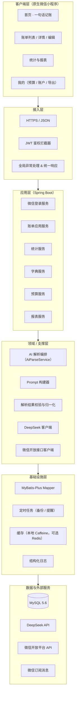
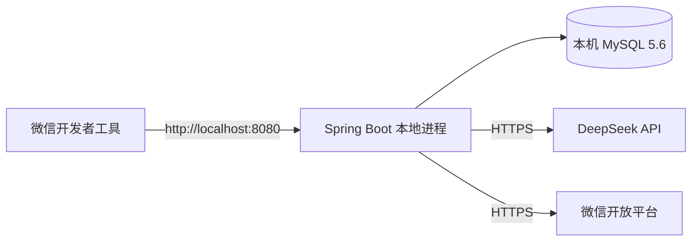
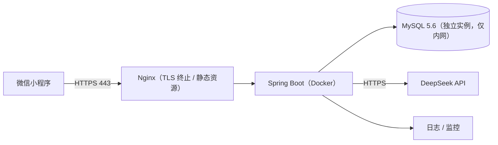
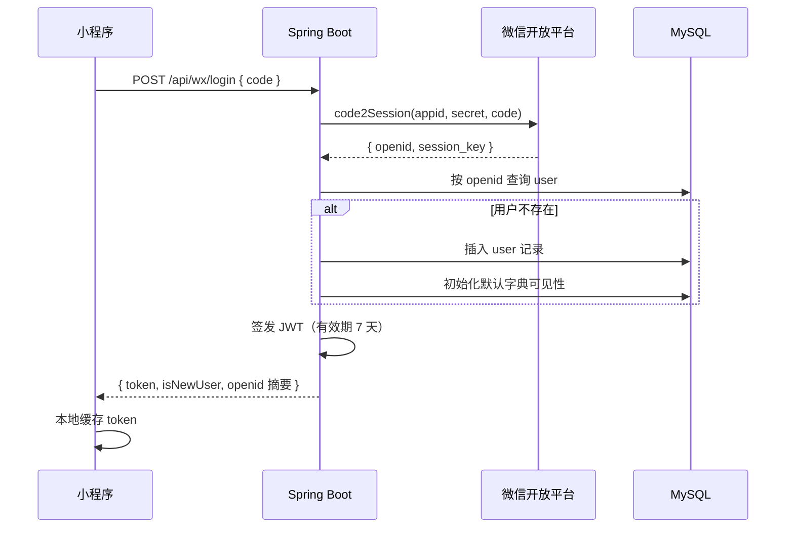
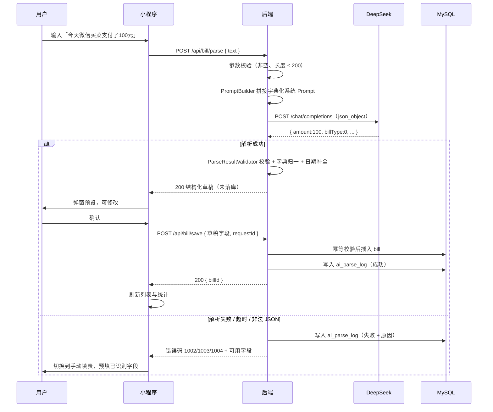
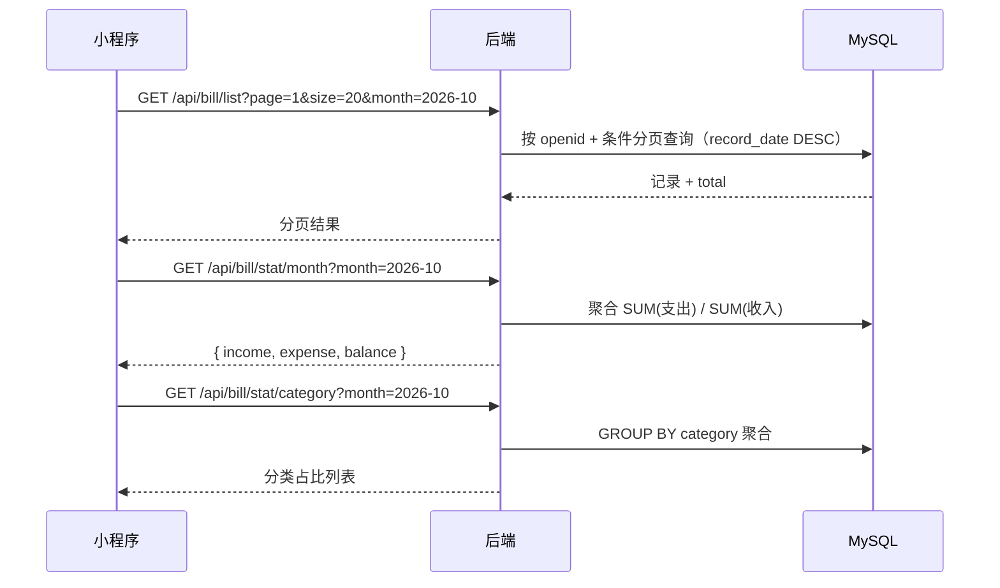

# AI 智能记账小程序 · 概要设计说明书（HLD）

| 项目 | 内容 |
| --- | --- |
| 项目名称 | AI 智能记账小程序 |
| 文档类型 | 概要设计说明书（High-Level Design） |
| 文档版本 | V1.1 |
| 编制日期 | 2026-10-04 |
| 上游文档 | 《01-需求规格说明书》 |
| 下游文档 | 《03-数据库设计说明书》《04-接口设计说明书》 |

## 修订记录

| 版本 | 日期 | 修订说明 |
| --- | --- | --- |
| V1.0 | 2026-10-04 | 首次编制，覆盖 V1 全部设计，V2/V3 给出扩展设计位 |
| V1.1 | 2026-10-05 | V2 启动：§7 补充搜索筛选与标签、预算、多轮补全的概要设计说明 |

---

## 1. 引言

### 1.1 编写目的

将《需求规格说明书》中的需求转化为可落地的系统结构设计，明确分层架构、模块划分、核心流程、关键技术方案与部署形态，作为详细设计与编码的直接依据。

### 1.2 设计原则

1. **解析与落库分离**：AI 解析只产出一份「待确认草稿」，不直接写库，用户确认后才持久化。
2. **字典驱动**：分类、渠道以字典表为准，Prompt 由字典动态拼接，杜绝同义词脏数据。
3. **失败可降级**：任何 AI 异常都必须回落到手动记账路径，主流程永不断路。
4. **配置化**：模型名、超时、Prompt 模板、开关均外置为配置，禁止硬编码。
5. **面向演进**：V1 结构不做过度设计，但为主键、字典、账本等维度预留扩展位。

---

## 2. 系统总体架构

### 2.1 分层架构



### 2.2 分层职责

| 层次 | 职责 | 禁止事项 |
| --- | --- | --- |
| 客户端层 | 采集输入、展示结果、本地交互状态 | 不得存放任何密钥；不得直连 DeepSeek |
| 接入层 | 鉴权、参数校验、异常兜底、统一响应包装 | 不承载业务逻辑 |
| 应用层 | 编排业务流程、事务边界控制 | 不直接拼写 SQL |
| 领域/支撑层 | AI 解析编排、Prompt 构建、结果校验、第三方客户端 | 不做持久化 |
| 基础设施层 | 数据访问、缓存、日志、定时任务 | 不含业务判断 |

### 2.3 部署形态

**开发阶段（本地）**



**生产阶段（云服务器）**



---

## 3. 技术选型与理由

| 层面 | 选型 | 版本基线 | 选择理由 |
| --- | --- | --- | --- |
| 小程序 | 原生微信小程序 | 基础库 ≥ 2.30 | 语音、订阅消息等微信能力支持最完整，无跨端诉求 |
| 后端框架 | Spring Boot | 3.2.x | 生态成熟，自动配置降低搭建成本 |
| JDK | OpenJDK | 17（LTS） | Spring Boot 3.x 最低要求 |
| 持久层 | MyBatis-Plus | 3.5.x（`mybatis-plus-spring-boot3-starter`） | 单表 CRUD 免写 SQL，支持字段自动填充 |
| 数据库 | MySQL | 5.6 | 沿用既有环境 |
| 连接池 | HikariCP | Spring Boot 内置 | 性能与稳定性好，零额外依赖 |
| JSON | Jackson | Spring Boot 内置 | 与 Spring Web 天然集成 |
| 参数校验 | Jakarta Validation | Spring Boot 内置 | 声明式校验，边界清晰 |
| 鉴权 | JJWT | 0.12.x | JWT 签发与校验，轻量无状态 |
| HTTP 客户端 | OkHttp 或 Spring `RestClient` | — | 调用 DeepSeek 与微信接口 |
| 缓存 | Caffeine（本地） | 3.x | V1 单机部署足够；V2 视情况引入 Redis |
| 定时任务 | Spring `@Scheduled` | — | 备份、预算检查等轻量任务 |
| 构建 | Maven | 3.9.x | — |
| 部署 | Docker + Nginx | — | 环境一致性，TLS 终止 |

> **注意**：使用 Spring Boot 3.x 时，必须选用 `mybatis-plus-spring-boot3-starter`，普通 `mybatis-plus-boot-starter` 会因 Jakarta 包名变更而启动失败。

---

## 4. 模块划分与包结构

```
com.smartledger
├── SmartLedgerApplication.java         启动类
├── common                               公共层
│   ├── result/                          统一响应体 R<T>、分页结果
│   ├── exception/                       业务异常、全局异常处理器
│   ├── enums/                           错误码、收支类型枚举
│   ├── constant/                        常量（缓存 Key、字典编码）
│   └── util/                            日期、金额、JSON 工具
├── config                               配置层
│   ├── MybatisPlusConfig                分页插件、字段自动填充
│   ├── WebMvcConfig                     拦截器注册、CORS
│   ├── JwtProperties / AiProperties     配置绑定
│   └── RestClientConfig                 第三方 HTTP 客户端
├── interceptor
│   └── JwtAuthInterceptor               鉴权拦截器
├── controller                           接口层
│   ├── WxController                     登录
│   ├── BillController                   记账 / 账单 / 统计
│   ├── DictController                   字典
│   ├── TemplateController               模板（V2）
│   ├── BudgetController                 预算（V2）
│   ├── BookController                   账本（V3）
│   └── ExportController                 导出（V3）
├── service                              应用服务层
│   ├── WxLoginService
│   ├── BillService / BillServiceImpl
│   ├── StatService / StatServiceImpl
│   ├── DictService
│   └── BudgetService / BookService ...
├── ai                                    AI 解析领域
│   ├── AiParseService                   解析编排（核心）
│   ├── PromptBuilder                    系统 Prompt 动态构建
│   ├── ParseResultValidator             字段校验与字典归一
│   ├── DeepSeekClient                   DeepSeek HTTP 客户端
│   └── dto/                             AiParseResult、AiRawResponse
├── mapper                               数据访问层
│   └── XxxMapper （继承 BaseMapper）
├── entity                               数据库实体
├── dto                                   请求/响应对象
│   ├── request/
│   └── response/
├── converter                            实体与 DTO 转换
└── task                                 定时任务（V3）
```

---

## 5. 核心流程设计

### 5.1 微信登录流程



### 5.2 一句话记账流程（核心）



### 5.3 账单查询与统计流程



---

## 6. AI 解析层设计（核心）

### 6.1 组件职责

| 组件 | 职责 |
| --- | --- |
| `PromptBuilder` | 读取 `category` / `pay_channel` 字典，动态生成系统 Prompt，保证模型只能从合法取值中选择 |
| `DeepSeekClient` | 封装 HTTP 调用、超时控制、重试、异常转换 |
| `AiParseService` | 解析编排：构建 Prompt → 调用模型 → 解析 JSON → 校验归一 → 记录日志 → 返回结果 |
| `ParseResultValidator` | 字段非空校验、数值范围校验、字典命中校验、日期合法性校验 |
| `AiParseLogService` | 记录输入、输出、耗时、成功/失败与失败原因 |

### 6.2 系统 Prompt 模板（配置化）

```
你是专业记账文本解析器。只输出纯净 JSON，不要解释、不要 markdown 代码块、不要多余文字。
严格按以下字段解析用户输入：

amount：金额，数字类型（保留两位小数），无法识别填 0
billType：0=支出，1=收入
payChannel：支付渠道，只能从以下取值中选择：{channels}
category：消费/收入分类，只能从以下取值中选择：{categories}
recordDate：日期，格式 yyyy-MM-dd，未说明日期默认今天（今天为 {today}）
remark：简短中文备注，概括本次消费
confidence：0~1 的小数，表示你对本次解析的把握程度

用户输入内容：【{text}】
```

> `{channels}` / `{categories}` 由 `PromptBuilder` 从字典表查询后拼接；`{today}` 由服务端注入，避免模型自行推算日期。

### 6.3 输出契约与调用参数

| 项 | 取值 |
| --- | --- |
| 接口 | `POST https://api.deepseek.com/chat/completions` |
| 模型 | `deepseek-flash`（配置项 `ai.model`，禁止硬编码） |
| 结构化保证 | `response_format = {"type": "json_object"}`，Prompt 中同时出现「JSON」字样 |
| temperature | 0.1 ~ 0.3（数据抽取场景需稳定输出） |
| max_tokens | 256 足够（输出仅一个短 JSON） |
| 超时 | 连接 3s / 读取 12s，总超时 15s |
| 重试 | 仅对超时与 5xx 重试 1 次，指数退避 |

**标准输出示例**

```json
{
  "amount": 100.00,
  "billType": 0,
  "payChannel": "微信",
  "category": "买菜餐饮",
  "recordDate": "2026-10-04",
  "remark": "日常买菜消费",
  "confidence": 0.95
}
```

### 6.4 校验与归一化规则

| 字段 | 规则 | 违规处理 |
| --- | --- | --- |
| amount | 必须为数字且 > 0 | 归 0 → 返回 1004，引导手动填写 |
| billType | 必须为 0 或 1 | 默认按 0（支出）处理 |
| payChannel | 必须命中渠道字典 | 映射为「其他」 |
| category | 必须命中对应收支类型的分类字典 | 映射为「其他支出 / 其他收入」 |
| recordDate | 合法日期且不晚于今天 + 1 天 | 回退为「今天」 |
| remark | 长度 ≤ 100 | 截断 |
| confidence | 0~1 | 缺失按 0.6 处理；< 0.5 时前端高亮提示用户复核 |

### 6.5 成本与稳定性控制

- **短时缓存**：对「同一用户 + 相同文本」做 60 秒本地缓存，避免用户连点重复调用。
- **长度限制**：单次输入 ≤ 200 字符，超长直接拒绝（400），防止无意义的长文本消耗 token。
- **失败熔断**：连续 N 次（默认 5）调用失败时，短时间内直接走兜底路径并告警，避免雪崩式的等待。
- **日志留痕**：每次调用记录 token 消耗，便于成本核算。

---

## 7. 关键技术方案

### 7.1 MySQL 5.6 适配方案

| 问题 | 方案 |
| --- | --- |
| 字符集 | 使用 `utf8mb4`（MySQL 5.6 自 5.5.3 起支持）。连接串与表结构均显式声明，避免用户输入 emoji 报错 |
| 索引前缀长度 | 默认 COMPACT 行格式下索引前缀上限 767 字节。需建索引的字符串字段统一 `varchar(191)`；若确需更长前缀，需额外开启 `innodb_file_format=Barracuda` + `innodb_large_prefix=ON` 并使用 `ROW_FORMAT=DYNAMIC` |
| 时间默认值 | MySQL 5.6 单表仅允许一个列使用 `DEFAULT CURRENT_TIMESTAMP`。统一约定：`create_time` / `update_time` 全部由应用层写入，数据库不设默认值 |
| JSON 类型 | 5.6 无原生 JSON 列。解析结果拆分为普通列存储，禁止以 JSON 字符串塞字段 |
| 排序规则 | 采用 `utf8mb4_general_ci` |

### 7.2 时间与字段自动填充

使用 MyBatis-Plus `MetaObjectHandler` 统一填充：

| 字段 | 填充时机 | 值 |
| --- | --- | --- |
| `create_time` | insert | `LocalDateTime.now()` |
| `update_time` | insert / update | `LocalDateTime.now()` |

实体上通过 `@TableField(fill = FieldFill.INSERT)` / `INSERT_UPDATE` 标注，避免在每个 Service 中重复赋值。

### 7.3 幂等设计

`/api/bill/save` 由小程序生成 `requestId`（UUID），后端建立短时唯一约束：

- 方案：Redis / Caffeine 缓存 `requestId`，或对 `bill` 表增加 `request_id` 唯一索引。
- 效果：用户重复点击保存不会产生重复账单（对应 NF-07）。

### 7.4 事务边界

- `save` 账单：单表单条写入，本身天然原子；若联动「更新账户余额」（V3），需在同一事务内完成。
- `import` 批量导入：以批次为单位控制事务，单条失败记录到失败明细，不整体回滚。
- `book/split` AA 分账：主账单 + 分摊明细需在同一事务内写入。

### 7.5 缓存策略

| 缓存对象 | 存储 | 过期 | 说明 |
| --- | --- | --- | --- |
| 字典（分类/渠道） | Caffeine | 10 分钟 | 变化频率低，减少 DB 查询与 Prompt 构建开销 |
| 解析结果 | Caffeine | 60 秒 | 防连点重复调用 |
| 用户信息 | Caffeine | 5 分钟 | 鉴权时减少查询 |

---

## 8. 异常与容错设计

### 8.1 错误码分层

| 区间 | 含义 | 示例 |
| --- | --- | --- |
| 0 | 成功 | — |
| 4xx | 客户端错误 | 400 参数错误、401 未登录、403 越权、404 不存在 |
| 5xx | 服务端错误 | 500 系统异常 |
| 1xxx | 业务错误 | 1001 微信登录失败、1002 AI 解析失败、1003 AI 输出非法、1004 金额无法识别、1005 疑似重复、1006 导入文件格式错误 |

### 8.2 容错矩阵

| 故障场景 | 检测方式 | 处理策略 | 用户感知 |
| --- | --- | --- | --- |
| DeepSeek 超时 | 读超时 12s | 重试 1 次，仍失败则返回 1002 | 提示「AI 解析超时，请手动填写」，自动切手动表单 |
| DeepSeek 返回非 JSON | JSON 解析失败 | 返回 1003，记录原始响应 | 同上 |
| 金额为 0 | 校验 | 返回 1004，预填其他字段 | 手动补金额即可保存 |
| 微信 code2Session 失败 | 错误码非 0 | 返回 1001 | 提示重新登录 |
| JWT 过期 | 拦截器校验 | 返回 401 | 小程序静默重新登录 |
| 数据库连接异常 | 连接池异常 | 返回 500，记 error 日志 | 提示稍后重试 |
| 重复点击保存 | requestId 命中 | 返回既有账单 ID | 无感知，不产生重复记录 |

### 8.3 全局异常处理

`@RestControllerAdvice` 统一捕获：业务异常（`BizException`）→ 返回对应错误码；参数校验异常（`MethodArgumentNotValidException`）→ 400；其余未捕获异常 → 500 并记录完整堆栈，响应中不暴露内部细节。

---

## 9. 安全设计

| 项 | 措施 |
| --- | --- |
| 密钥管理 | AppSecret、DeepSeek Key、DB 口令存于服务端环境变量或 `application-{env}.yml`，加入 `.gitignore`，禁止入库 |
| 鉴权 | 除 `/api/wx/login` 外全部接口经 `JwtAuthInterceptor` 校验；token 中携带 openid |
| 越权防护 | 所有账单查询/修改/删除均以 JWT 中的 openid 为过滤条件，禁止信任前端传入的 openid |
| 输入校验 | 文本长度、分页参数、金额范围、日期格式全部服务端校验 |
| 传输安全 | 生产环境 HTTPS；小程序 `request` 合法域名白名单配置后端域名 |
| 日志脱敏 | 日志不打印完整 JWT、AppSecret、API Key；用户输入文本按需截断记录 |
| 限流 | 对 `/api/bill/parse` 做单用户频率限制（如 20 次/分钟），防止刷接口消耗 token |

---

## 10. 部署方案

### 10.1 环境划分

| 环境 | 用途 | 数据库 | 域名 |
| --- | --- | --- | --- |
| dev | 本地开发 | 本机 MySQL 5.6 | localhost:8080 |
| prod | 生产运行 | 云数据库 MySQL 5.6 | https://api.xxx.com（已备案） |

### 10.2 生产部署要点

- 后端以 Docker 镜像发布，`JAVA_OPTS` 设置合理堆内存。
- Nginx 负责 TLS 终止、反向代理与静态资源；仅暴露 443。
- MySQL 仅开放内网访问，禁止公网直连。
- 通过环境变量注入密钥，镜像中不落任何敏感信息。
- 配置健康检查接口 `/actuator/health`（或自定义 `/api/health`）。
- 日志落盘并配置切割，关键错误接入告警。

---

## 11. 配置项清单

```yaml
server:
  port: 8080

spring:
  datasource:
    driver-class-name: com.mysql.cj.jdbc.Driver
    url: jdbc:mysql://localhost:3306/smart_ledger?useUnicode=true&characterEncoding=UTF-8&useSSL=false&serverTimezone=Asia/Shanghai&allowPublicKeyRetrieval=true
    username: ${DB_USER}
    password: ${DB_PASSWORD}
    hikari:
      maximum-pool-size: 10
      minimum-idle: 2

mybatis-plus:
  mapper-locations: classpath*:/mapper/**/*.xml
  global-config:
    db-config:
      id-type: auto
  configuration:
    map-underscore-to-camel-case: true

smartledger:
  jwt:
    secret: ${JWT_SECRET}
    expire-days: 7
  wx:
    app-id: ${WX_APP_ID}
    app-secret: ${WX_APP_SECRET}
  ai:
    enabled: true
    base-url: https://api.deepseek.com
    api-key: ${DEEPSEEK_API_KEY}
    model: deepseek-flash
    connect-timeout: 3000
    read-timeout: 12000
    max-retries: 1
    temperature: 0.2
    cache-seconds: 60
    max-input-length: 200
    rate-limit-per-minute: 20
```

---

## 12. 扩展设计位（V2 / V3）

| 能力 | 设计要点 |
| --- | --- |
| 语音记账 | 小程序端录音 → 转文字（微信同声传译插件或云端 ASR）→ 复用 `/api/bill/parse`；后端无需改动 |
| 快捷模板 | 新增 `bill_template` 表；模板一键记账直接走 `save`，跳过 AI |
| 多轮补全 | 复用解析响应的 `missingFields`，由小程序发起追问，最多 2 轮，第 3 轮降级为手动表单，后端接口不变 |
| 个人词典 | `alias_dict` 表；解析前先做别名替换，命中则不调用 AI（省成本、提准确率） |
| 账单导入 | 文件解析 + 逐行调用（或批量压缩为一次调用）；以 `import_record` 记录批次，支持整批撤销 |
| 搜索筛选与标签 | 复用 `bill.tags` 字段（不建标签表）；`/api/bill/list` 增加金额区间 / 日期区间 / 标签 / 来源参数；标签联想走 `/api/bill/tag/suggest` |
| 预算 | `budget` 表按「月份 + 分类」唯一；`/api/budget` 查询时与账单统计聚合相减得到已用与剩余 |
| 小票 OCR | 接入 OCR 服务提取文本 → 复用 AI 解析链路归类 |
| AI 月报 | 先由 SQL 聚合出真实统计数据，再把「统计数据」交给模型生成文字，**禁止让模型直接读明细自行算数** |
| 共享账本 | 账单表增加 `book_id`；成员表 `book_member` 控制权限；查询需按账本维度过滤 |
| AA 分账 | 主账单 + 分摊明细表，同一事务写入，金额尾差归到最后一位分摊人 |
| 多币种 | `bill` 增加 `currency`、`exchange_rate`、`amount_cny`；统计统一按 `amount_cny` 汇总 |

---

> 文档结束。后续请阅读《03-数据库设计说明书》与《04-接口设计说明书》。