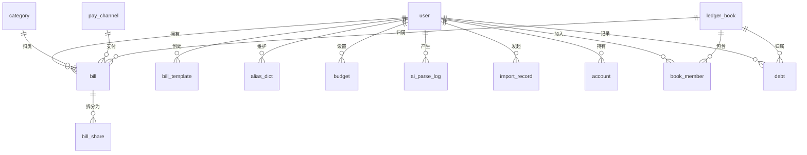

# AI 智能记账小程序 · 数据库设计说明书（DBD）

| 项目 | 内容 |
| --- | --- |
| 项目名称 | AI 智能记账小程序 |
| 数据库 | MySQL 5.6 |
| 库名 | `smart_ledger` |
| 字符集 | `utf8mb4` / `utf8mb4_general_ci` |
| 存储引擎 | InnoDB |
| 文档版本 | V1.1 |
| 编制日期 | 2026-10-04 |

## 修订记录

| 版本 | 日期 | 修订说明 |
| --- | --- | --- |
| V1.0 | 2026-10-04 | 首次编制，覆盖 V1 全部表结构，并预留 V2/V3 表 |
| V1.1 | 2026-10-05 | V2 启动：确认标签复用 `bill.tags`（逗号分隔）、不单独建标签表；四张 V2 表 `bill_template` / `alias_dict` / `budget` / `import_record` 已同步落库至 `schema.sql`；补充 V2 搜索筛选与重复检测的索引使用说明 |

---

## 1. 设计约定

| 约定项 | 规则 |
| --- | --- |
| 表名 | 小写下划线，单数形式，不加前缀 |
| 字段名 | 小写下划线；布尔语义用 `tinyint(1)` 或 `status` 表示 |
| 主键 | `id bigint unsigned NOT NULL AUTO_INCREMENT` |
| 金额 | `decimal(10,2)`；账户余额用 `decimal(12,2)`；禁止用 float/double |
| 时间 | 统一 `datetime`，**由应用层写入**，数据库不设默认值 |
| 逻辑删除 | `deleted tinyint(1) DEFAULT 0`（0 正常，1 删除） |
| 状态字段 | `status tinyint(1) DEFAULT 1`（1 启用，0 停用） |
| 字符集 | 全库 `utf8mb4`（MySQL 5.6 已支持），以兼容 emoji |
| 索引前缀 | 需建索引的字符串字段统一 `varchar(191)`，规避 COMPACT 行格式 767 字节限制 |

### 1.1 MySQL 5.6 关键限制与对策

| # | 限制 | 对策 |
| --- | --- | --- |
| 1 | 单表仅允许一个列使用 `DEFAULT CURRENT_TIMESTAMP` | 全部时间字段由 MyBatis-Plus `MetaObjectHandler` 填充，DDL 中不设默认值 |
| 2 | 默认 COMPACT 行格式下索引前缀上限 767 字节（utf8mb4 下即 191 字符） | 索引字段统一 `varchar(191)`；如确需更长前缀，需开启 `innodb_file_format=Barracuda` + `innodb_large_prefix=ON` 并使用 `ROW_FORMAT=DYNAMIC` |
| 3 | 无原生 JSON 数据类型 | AI 解析结果拆为普通列（`amount` / `pay_channel_code` / `category_code` / `record_date`）存储，日志类数据用 `text` |
| 4 | `utf8`（3 字节）无法存储 emoji | 使用 `utf8mb4`，否则用户备注中的 emoji 会导致写入失败 |

### 1.2 与旧表结构的兼容说明

原文档仅设计了 `user` 与 `bill` 两张表。本次重构保持这两张表的语义不变，并做如下调整：

- `bill.pay_channel` → `bill.pay_channel_code`（存字典编码，而非中文名）
- `bill.category` → `bill.category_code`（同上）
- 新增 `source`（来源）、`request_id`（幂等）、`deleted`（逻辑删除）、`confidence`（解析置信度）
- 新增字典表 `category` / `pay_channel`，以及日志、模板、预算等扩展表

---

## 2. 实体关系（ER）



---

## 3. 表清单

| # | 表名 | 中文名 | 版本 | 说明 |
| --- | --- | --- | --- | --- |
| 1 | `user` | 用户表 | V1 | 微信用户 |
| 2 | `category` | 分类字典表 | V1 | 支出/收入分类 |
| 3 | `pay_channel` | 渠道字典表 | V1 | 支付渠道 |
| 4 | `bill` | 账单表 | V1 | 核心业务表 |
| 5 | `ai_parse_log` | AI 解析日志表 | V1 | 解析可回溯 |
| 6 | `bill_template` | 快捷记账模板表 | V2 | 高频账目 |
| 7 | `alias_dict` | 别名词典表 | V2 | 个人词典 |
| 8 | `budget` | 预算表 | V2 | 总预算 / 分类预算 |
| 9 | `import_record` | 导入批次表 | V2 | 批量导入记录 |
| 10 | `account` | 资金账户表 | V3 | 资产总览 |
| 11 | `ledger_book` | 账本表 | V3 | 共享账本 |
| 12 | `book_member` | 账本成员表 | V3 | 成员与权限 |
| 13 | `bill_share` | 分摊明细表 | V3 | AA 分账 |
| 14 | `debt` | 借贷记录表 | V3 | 应收应付 |

---

## 4. 表结构详细设计

### 4.1 user 用户表

| 字段 | 类型 | 允许空 | 默认 | 说明 |
| --- | --- | --- | --- | --- |
| id | bigint unsigned | N | AUTO_INCREMENT | 主键 |
| openid | varchar(191) | N | — | 微信唯一标识 |
| unionid | varchar(191) | Y | NULL | 开放平台唯一标识（预留） |
| nickname | varchar(64) | Y | NULL | 昵称（用户可选授权） |
| status | tinyint | N | 1 | 1 正常，0 停用 |
| create_time | datetime | N | — | 应用层填充 |
| update_time | datetime | N | — | 应用层填充 |

**索引**：`PRIMARY KEY (id)`、`UNIQUE KEY uk_openid (openid)`

### 4.2 category 分类字典表

| 字段 | 类型 | 允许空 | 默认 | 说明 |
| --- | --- | --- | --- | --- |
| id | bigint unsigned | N | AUTO_INCREMENT | 主键 |
| code | varchar(32) | N | — | 分类编码，如 FOOD |
| name | varchar(32) | N | — | 分类名称，如 买菜餐饮 |
| bill_type | tinyint | N | 0 | 0 支出，1 收入 |
| icon | varchar(64) | Y | NULL | 图标标识 |
| sort_no | int | N | 0 | 排序 |
| is_system | tinyint | N | 1 | 1 系统内置，0 用户自定义 |
| status | tinyint | N | 1 | 1 启用，0 停用 |
| create_time | datetime | N | — | 应用层填充 |
| update_time | datetime | N | — | 应用层填充 |

**索引**：`UNIQUE KEY uk_code (code)`、`KEY idx_type_status (bill_type, status)`

### 4.3 pay_channel 渠道字典表

| 字段 | 类型 | 允许空 | 默认 | 说明 |
| --- | --- | --- | --- | --- |
| id | bigint unsigned | N | AUTO_INCREMENT | 主键 |
| code | varchar(32) | N | — | 渠道编码，如 WECHAT |
| name | varchar(32) | N | — | 渠道名称，如 微信 |
| icon | varchar(64) | Y | NULL | 图标标识 |
| sort_no | int | N | 0 | 排序 |
| status | tinyint | N | 1 | 1 启用，0 停用 |
| create_time | datetime | N | — | 应用层填充 |
| update_time | datetime | N | — | 应用层填充 |

**索引**：`UNIQUE KEY uk_code (code)`

### 4.4 bill 账单表（核心）

| 字段 | 类型 | 允许空 | 默认 | 说明 |
| --- | --- | --- | --- | --- |
| id | bigint unsigned | N | AUTO_INCREMENT | 主键 |
| openid | varchar(191) | N | — | 所属用户 |
| book_id | bigint unsigned | N | 0 | 所属账本，0 表示个人默认账本 |
| amount | decimal(10,2) | N | — | 金额，恒为正数 |
| bill_type | tinyint | N | 0 | 0 支出，1 收入 |
| pay_channel_code | varchar(32) | N | — | 渠道编码 |
| category_code | varchar(32) | N | — | 分类编码 |
| record_text | varchar(500) | Y | NULL | 用户原始输入文本 |
| remark | varchar(255) | Y | NULL | 备注 |
| record_date | date | N | — | 记账日期（统计口径以此为准） |
| source | tinyint | N | 1 | 1 文本 2 语音 3 模板 4 导入 5 OCR 6 手动 |
| confidence | decimal(3,2) | Y | NULL | AI 解析置信度 0~1 |
| tags | varchar(255) | Y | NULL | 标签，逗号分隔（V2） |
| request_id | varchar(64) | Y | NULL | 幂等标识 |
| deleted | tinyint | N | 0 | 0 正常，1 已删除 |
| create_time | datetime | N | — | 应用层填充 |
| update_time | datetime | N | — | 应用层填充 |

**索引**

| 索引名 | 字段 | 类型 | 用途 |
| --- | --- | --- | --- |
| PRIMARY | id | 主键 | — |
| uk_request_id | request_id | 唯一 | 幂等防重 |
| idx_openid_date | openid, record_date | 普通 | 列表分页、月度统计 |
| idx_openid_category | openid, category_code | 普通 | 分类统计与筛选 |
| idx_openid_channel | openid, pay_channel_code | 普通 | 渠道筛选 |
| idx_book_date | book_id, record_date | 普通 | 共享账本查询（V3） |

> 说明：`uk_request_id` 允许 NULL，MySQL 唯一索引对多个 NULL 值不冲突，因此不传 `request_id` 时不受影响。
>
> **V2 说明（搜索筛选 F-35 / 重复检测 F-37）**：标签复用 `tags` 字段（逗号分隔，按 `LIKE` 过滤；个人账本量级下可接受，**不单独建标签表**）；金额区间与关键字在 `idx_openid_date` 命中日期范围后由应用层过滤；重复检测按 `openid + record_date BETWEEN ? AND ?` 取候选集，再在应用层比对金额/渠道/分类，同样走 `idx_openid_date`。**V2 不新增索引**。

### 4.5 ai_parse_log AI 解析日志表

| 字段 | 类型 | 允许空 | 默认 | 说明 |
| --- | --- | --- | --- | --- |
| id | bigint unsigned | N | AUTO_INCREMENT | 主键 |
| openid | varchar(191) | N | — | 用户 |
| input_text | varchar(500) | N | — | 原始输入（超长截断） |
| output_json | text | Y | NULL | 模型原始输出 |
| model | varchar(64) | Y | NULL | 模型名 |
| success | tinyint | N | 0 | 1 成功，0 失败 |
| error_code | varchar(32) | Y | NULL | 失败错误码 |
| error_msg | varchar(255) | Y | NULL | 失败原因 |
| cost_ms | int | Y | NULL | 耗时（毫秒） |
| prompt_tokens | int | Y | NULL | 输入 token |
| completion_tokens | int | Y | NULL | 输出 token |
| create_time | datetime | N | — | 应用层填充 |

**索引**：`KEY idx_openid_time (openid, create_time)`

### 4.6 bill_template 快捷记账模板表（V2）

| 字段 | 类型 | 允许空 | 默认 | 说明 |
| --- | --- | --- | --- | --- |
| id | bigint unsigned | N | AUTO_INCREMENT | 主键 |
| openid | varchar(191) | N | — | 用户 |
| title | varchar(64) | N | — | 模板名称，如 早餐 |
| amount | decimal(10,2) | N | — | 金额 |
| bill_type | tinyint | N | 0 | 0 支出，1 收入 |
| pay_channel_code | varchar(32) | N | — | 渠道编码 |
| category_code | varchar(32) | N | — | 分类编码 |
| remark | varchar(255) | Y | NULL | 备注 |
| use_count | int | N | 0 | 使用次数（用于排序） |
| sort_no | int | N | 0 | 手动排序 |
| status | tinyint | N | 1 | 1 启用，0 停用 |
| create_time | datetime | N | — | 应用层填充 |
| update_time | datetime | N | — | 应用层填充 |

**索引**：`KEY idx_openid_status (openid, status)`

### 4.7 alias_dict 别名词典表（V2）

| 字段 | 类型 | 允许空 | 默认 | 说明 |
| --- | --- | --- | --- | --- |
| id | bigint unsigned | N | AUTO_INCREMENT | 主键 |
| openid | varchar(191) | N | — | 用户 |
| keyword | varchar(64) | N | — | 别名关键词，如 公司食堂 |
| target_type | tinyint | N | 1 | 1 映射到分类，2 映射到渠道 |
| target_code | varchar(32) | N | — | 目标字典编码 |
| hit_count | int | N | 0 | 命中次数 |
| status | tinyint | N | 1 | 1 启用，0 停用 |
| create_time | datetime | N | — | 应用层填充 |
| update_time | datetime | N | — | 应用层填充 |

**索引**：`UNIQUE KEY uk_openid_keyword (openid, keyword)`

### 4.8 budget 预算表（V2）

| 字段 | 类型 | 允许空 | 默认 | 说明 |
| --- | --- | --- | --- | --- |
| id | bigint unsigned | N | AUTO_INCREMENT | 主键 |
| openid | varchar(191) | N | — | 用户 |
| budget_month | char(7) | N | — | 预算月份，格式 yyyy-MM |
| category_code | varchar(32) | N | '' | 空字符串表示总预算 |
| amount | decimal(10,2) | N | — | 预算金额 |
| warn_ratio | decimal(5,2) | N | 0.80 | 预警阈值比例 |
| status | tinyint | N | 1 | 1 启用，0 停用 |
| create_time | datetime | N | — | 应用层填充 |
| update_time | datetime | N | — | 应用层填充 |

**索引**：`UNIQUE KEY uk_openid_month_cat (openid, budget_month, category_code)`

### 4.9 import_record 导入批次表（V2）

| 字段 | 类型 | 允许空 | 默认 | 说明 |
| --- | --- | --- | --- | --- |
| id | bigint unsigned | N | AUTO_INCREMENT | 主键 |
| openid | varchar(191) | N | — | 用户 |
| file_name | varchar(255) | Y | NULL | 原文件名 |
| source_type | varchar(32) | N | — | WECHAT / ALIPAY |
| total_count | int | N | 0 | 总条数 |
| success_count | int | N | 0 | 成功条数 |
| fail_count | int | N | 0 | 失败条数 |
| status | tinyint | N | 0 | 0 处理中 1 成功 2 部分失败 3 已撤销 |
| fail_detail | text | Y | NULL | 失败明细 |
| create_time | datetime | N | — | 应用层填充 |
| update_time | datetime | N | — | 应用层填充 |

**索引**：`KEY idx_openid_time (openid, create_time)`

### 4.10 account 资金账户表（V3）

| 字段 | 类型 | 允许空 | 默认 | 说明 |
| --- | --- | --- | --- | --- |
| id | bigint unsigned | N | AUTO_INCREMENT | 主键 |
| openid | varchar(191) | N | — | 用户 |
| name | varchar(64) | N | — | 账户名称，如 招行储蓄卡 |
| type | varchar(32) | N | — | BANK / ALIPAY / WECHAT / CASH / INVEST |
| balance | decimal(12,2) | N | 0.00 | 当前余额 |
| icon | varchar(64) | Y | NULL | 图标 |
| sort_no | int | N | 0 | 排序 |
| status | tinyint | N | 1 | 1 启用，0 停用 |
| create_time | datetime | N | — | 应用层填充 |
| update_time | datetime | N | — | 应用层填充 |

**索引**：`KEY idx_openid_status (openid, status)`

### 4.11 ledger_book 账本表（V3）

| 字段 | 类型 | 允许空 | 默认 | 说明 |
| --- | --- | --- | --- | --- |
| id | bigint unsigned | N | AUTO_INCREMENT | 主键 |
| name | varchar(64) | N | — | 账本名称，如 家庭账本 |
| owner_openid | varchar(191) | N | — | 创建者 |
| invite_code | varchar(16) | N | — | 邀请码 |
| member_count | int | N | 1 | 成员数（冗余，便于展示） |
| status | tinyint | N | 1 | 1 正常，0 已解散 |
| create_time | datetime | N | — | 应用层填充 |
| update_time | datetime | N | — | 应用层填充 |

**索引**：`UNIQUE KEY uk_invite_code (invite_code)`、`KEY idx_owner (owner_openid)`

### 4.12 book_member 账本成员表（V3）

| 字段 | 类型 | 允许空 | 默认 | 说明 |
| --- | --- | --- | --- | --- |
| id | bigint unsigned | N | AUTO_INCREMENT | 主键 |
| book_id | bigint unsigned | N | — | 账本 ID |
| openid | varchar(191) | N | — | 成员 |
| role | tinyint | N | 2 | 1 创建者，2 普通成员 |
| nick_name | varchar(64) | Y | NULL | 账本内昵称 |
| status | tinyint | N | 1 | 1 在册，0 已退出 |
| create_time | datetime | N | — | 应用层填充 |
| update_time | datetime | N | — | 应用层填充 |

**索引**：`UNIQUE KEY uk_book_openid (book_id, openid)`、`KEY idx_openid (openid)`

### 4.13 bill_share 分摊明细表（V3）

| 字段 | 类型 | 允许空 | 默认 | 说明 |
| --- | --- | --- | --- | --- |
| id | bigint unsigned | N | AUTO_INCREMENT | 主键 |
| bill_id | bigint unsigned | N | — | 主账单 ID |
| openid | varchar(191) | N | — | 分摊人 |
| share_amount | decimal(10,2) | N | — | 该人应付金额 |
| settled | tinyint | N | 0 | 0 未结清，1 已结清 |
| create_time | datetime | N | — | 应用层填充 |

**索引**：`KEY idx_bill_id (bill_id)`、`KEY idx_openid_settled (openid, settled)`

### 4.14 debt 借贷记录表（V3）

| 字段 | 类型 | 允许空 | 默认 | 说明 |
| --- | --- | --- | --- | --- |
| id | bigint unsigned | N | AUTO_INCREMENT | 主键 |
| openid | varchar(191) | N | — | 记录人 |
| book_id | bigint unsigned | N | 0 | 所属账本 |
| direction | tinyint | N | 1 | 1 借出（应收），2 借入（应付） |
| counterparty | varchar(64) | N | — | 对方姓名 |
| amount | decimal(10,2) | N | — | 总额 |
| settled_amount | decimal(10,2) | N | 0.00 | 已结金额 |
| status | tinyint | N | 0 | 0 未结清，1 已结清 |
| happened_date | date | N | — | 发生日期 |
| due_date | date | Y | NULL | 约定归还日期 |
| remark | varchar(255) | Y | NULL | 备注 |
| create_time | datetime | N | — | 应用层填充 |
| update_time | datetime | N | — | 应用层填充 |

**索引**：`KEY idx_openid_status (openid, status)`

---

## 5. 建表 SQL（MySQL 5.6 可直接执行）

```sql
CREATE DATABASE IF NOT EXISTS `smart_ledger`
  DEFAULT CHARACTER SET utf8mb4
  COLLATE utf8mb4_general_ci;

USE `smart_ledger`;

-- ============ 1. 用户表 ============
CREATE TABLE `user` (
  `id`          BIGINT UNSIGNED NOT NULL AUTO_INCREMENT COMMENT '主键',
  `openid`      VARCHAR(191)    NOT NULL                COMMENT '微信唯一标识',
  `unionid`     VARCHAR(191)    DEFAULT NULL            COMMENT '开放平台唯一标识',
  `nickname`    VARCHAR(64)     DEFAULT NULL            COMMENT '昵称',
  `status`      TINYINT         NOT NULL DEFAULT 1      COMMENT '1正常 0停用',
  `create_time` DATETIME        NOT NULL                COMMENT '创建时间(应用层填充)',
  `update_time` DATETIME        NOT NULL                COMMENT '更新时间(应用层填充)',
  PRIMARY KEY (`id`),
  UNIQUE KEY `uk_openid` (`openid`)
) ENGINE=InnoDB DEFAULT CHARSET=utf8mb4 COLLATE=utf8mb4_general_ci COMMENT='用户表';

-- ============ 2. 分类字典表 ============
CREATE TABLE `category` (
  `id`          BIGINT UNSIGNED NOT NULL AUTO_INCREMENT COMMENT '主键',
  `code`        VARCHAR(32)     NOT NULL                COMMENT '分类编码',
  `name`        VARCHAR(32)     NOT NULL                COMMENT '分类名称',
  `bill_type`   TINYINT         NOT NULL DEFAULT 0      COMMENT '0支出 1收入',
  `icon`        VARCHAR(64)     DEFAULT NULL            COMMENT '图标',
  `sort_no`     INT             NOT NULL DEFAULT 0      COMMENT '排序',
  `is_system`   TINYINT         NOT NULL DEFAULT 1      COMMENT '1内置 0自定义',
  `status`      TINYINT         NOT NULL DEFAULT 1      COMMENT '1启用 0停用',
  `create_time` DATETIME        NOT NULL                COMMENT '创建时间',
  `update_time` DATETIME        NOT NULL                COMMENT '更新时间',
  PRIMARY KEY (`id`),
  UNIQUE KEY `uk_code` (`code`),
  KEY `idx_type_status` (`bill_type`, `status`)
) ENGINE=InnoDB DEFAULT CHARSET=utf8mb4 COLLATE=utf8mb4_general_ci COMMENT='分类字典表';

-- ============ 3. 渠道字典表 ============
CREATE TABLE `pay_channel` (
  `id`          BIGINT UNSIGNED NOT NULL AUTO_INCREMENT COMMENT '主键',
  `code`        VARCHAR(32)     NOT NULL                COMMENT '渠道编码',
  `name`        VARCHAR(32)     NOT NULL                COMMENT '渠道名称',
  `icon`        VARCHAR(64)     DEFAULT NULL            COMMENT '图标',
  `sort_no`     INT             NOT NULL DEFAULT 0      COMMENT '排序',
  `status`      TINYINT         NOT NULL DEFAULT 1      COMMENT '1启用 0停用',
  `create_time` DATETIME        NOT NULL                COMMENT '创建时间',
  `update_time` DATETIME        NOT NULL                COMMENT '更新时间',
  PRIMARY KEY (`id`),
  UNIQUE KEY `uk_code` (`code`)
) ENGINE=InnoDB DEFAULT CHARSET=utf8mb4 COLLATE=utf8mb4_general_ci COMMENT='渠道字典表';

-- ============ 4. 账单表 ============
CREATE TABLE `bill` (
  `id`               BIGINT UNSIGNED NOT NULL AUTO_INCREMENT COMMENT '主键',
  `openid`           VARCHAR(191)    NOT NULL                COMMENT '所属用户',
  `book_id`          BIGINT UNSIGNED NOT NULL DEFAULT 0      COMMENT '账本ID,0=个人默认',
  `amount`           DECIMAL(10,2)   NOT NULL                COMMENT '金额(正数)',
  `bill_type`        TINYINT         NOT NULL DEFAULT 0      COMMENT '0支出 1收入',
  `pay_channel_code` VARCHAR(32)     NOT NULL                COMMENT '渠道编码',
  `category_code`    VARCHAR(32)     NOT NULL                COMMENT '分类编码',
  `record_text`      VARCHAR(500)    DEFAULT NULL            COMMENT '用户原始输入',
  `remark`           VARCHAR(255)    DEFAULT NULL            COMMENT '备注',
  `record_date`      DATE            NOT NULL                COMMENT '记账日期',
  `source`           TINYINT         NOT NULL DEFAULT 1      COMMENT '1文本2语音3模板4导入5OCR6手动',
  `confidence`       DECIMAL(3,2)    DEFAULT NULL            COMMENT '解析置信度',
  `tags`             VARCHAR(255)    DEFAULT NULL            COMMENT '标签,逗号分隔',
  `request_id`       VARCHAR(64)     DEFAULT NULL            COMMENT '幂等标识',
  `deleted`          TINYINT         NOT NULL DEFAULT 0      COMMENT '0正常 1删除',
  `create_time`      DATETIME        NOT NULL                COMMENT '创建时间',
  `update_time`      DATETIME        NOT NULL                COMMENT '更新时间',
  PRIMARY KEY (`id`),
  UNIQUE KEY `uk_request_id` (`request_id`),
  KEY `idx_openid_date` (`openid`, `record_date`),
  KEY `idx_openid_category` (`openid`, `category_code`),
  KEY `idx_openid_channel` (`openid`, `pay_channel_code`),
  KEY `idx_book_date` (`book_id`, `record_date`)
) ENGINE=InnoDB DEFAULT CHARSET=utf8mb4 COLLATE=utf8mb4_general_ci COMMENT='账单表';

-- ============ 5. AI 解析日志表 ============
CREATE TABLE `ai_parse_log` (
  `id`                BIGINT UNSIGNED NOT NULL AUTO_INCREMENT COMMENT '主键',
  `openid`            VARCHAR(191)    NOT NULL                COMMENT '用户',
  `input_text`        VARCHAR(500)    NOT NULL                COMMENT '原始输入',
  `output_json`       TEXT            DEFAULT NULL            COMMENT '模型原始输出',
  `model`             VARCHAR(64)     DEFAULT NULL            COMMENT '模型名',
  `success`           TINYINT         NOT NULL DEFAULT 0      COMMENT '1成功 0失败',
  `error_code`        VARCHAR(32)     DEFAULT NULL            COMMENT '错误码',
  `error_msg`         VARCHAR(255)    DEFAULT NULL            COMMENT '错误原因',
  `cost_ms`           INT             DEFAULT NULL            COMMENT '耗时ms',
  `prompt_tokens`     INT             DEFAULT NULL            COMMENT '输入token',
  `completion_tokens` INT             DEFAULT NULL            COMMENT '输出token',
  `create_time`       DATETIME        NOT NULL                COMMENT '创建时间',
  PRIMARY KEY (`id`),
  KEY `idx_openid_time` (`openid`, `create_time`)
) ENGINE=InnoDB DEFAULT CHARSET=utf8mb4 COLLATE=utf8mb4_general_ci COMMENT='AI解析日志表';

-- ============ 6. 快捷记账模板表(V2) ============
CREATE TABLE `bill_template` (
  `id`               BIGINT UNSIGNED NOT NULL AUTO_INCREMENT COMMENT '主键',
  `openid`           VARCHAR(191)    NOT NULL                COMMENT '用户',
  `title`            VARCHAR(64)     NOT NULL                COMMENT '模板名称',
  `amount`           DECIMAL(10,2)   NOT NULL                COMMENT '金额',
  `bill_type`        TINYINT         NOT NULL DEFAULT 0      COMMENT '0支出 1收入',
  `pay_channel_code` VARCHAR(32)     NOT NULL                COMMENT '渠道编码',
  `category_code`    VARCHAR(32)     NOT NULL                COMMENT '分类编码',
  `remark`           VARCHAR(255)    DEFAULT NULL            COMMENT '备注',
  `use_count`        INT             NOT NULL DEFAULT 0      COMMENT '使用次数',
  `sort_no`          INT             NOT NULL DEFAULT 0      COMMENT '排序',
  `status`           TINYINT         NOT NULL DEFAULT 1      COMMENT '1启用 0停用',
  `create_time`      DATETIME        NOT NULL                COMMENT '创建时间',
  `update_time`      DATETIME        NOT NULL                COMMENT '更新时间',
  PRIMARY KEY (`id`),
  KEY `idx_openid_status` (`openid`, `status`)
) ENGINE=InnoDB DEFAULT CHARSET=utf8mb4 COLLATE=utf8mb4_general_ci COMMENT='快捷记账模板表';

-- ============ 7. 别名词典表(V2) ============
CREATE TABLE `alias_dict` (
  `id`          BIGINT UNSIGNED NOT NULL AUTO_INCREMENT COMMENT '主键',
  `openid`      VARCHAR(191)    NOT NULL                COMMENT '用户',
  `keyword`     VARCHAR(64)     NOT NULL                COMMENT '别名关键词',
  `target_type` TINYINT         NOT NULL DEFAULT 1      COMMENT '1分类 2渠道',
  `target_code` VARCHAR(32)     NOT NULL                COMMENT '目标编码',
  `hit_count`   INT             NOT NULL DEFAULT 0      COMMENT '命中次数',
  `status`      TINYINT         NOT NULL DEFAULT 1      COMMENT '1启用 0停用',
  `create_time` DATETIME        NOT NULL                COMMENT '创建时间',
  `update_time` DATETIME        NOT NULL                COMMENT '更新时间',
  PRIMARY KEY (`id`),
  UNIQUE KEY `uk_openid_keyword` (`openid`, `keyword`)
) ENGINE=InnoDB DEFAULT CHARSET=utf8mb4 COLLATE=utf8mb4_general_ci COMMENT='别名词典表';

-- ============ 8. 预算表(V2) ============
CREATE TABLE `budget` (
  `id`            BIGINT UNSIGNED NOT NULL AUTO_INCREMENT COMMENT '主键',
  `openid`        VARCHAR(191)    NOT NULL                COMMENT '用户',
  `budget_month`  CHAR(7)         NOT NULL                COMMENT '预算月份yyyy-MM',
  `category_code` VARCHAR(32)     NOT NULL DEFAULT ''     COMMENT '空=总预算',
  `amount`        DECIMAL(10,2)   NOT NULL                COMMENT '预算金额',
  `warn_ratio`    DECIMAL(5,2)    NOT NULL DEFAULT 0.80  COMMENT '预警比例',
  `status`        TINYINT         NOT NULL DEFAULT 1      COMMENT '1启用 0停用',
  `create_time`   DATETIME        NOT NULL                COMMENT '创建时间',
  `update_time`   DATETIME        NOT NULL                COMMENT '更新时间',
  PRIMARY KEY (`id`),
  UNIQUE KEY `uk_openid_month_cat` (`openid`, `budget_month`, `category_code`)
) ENGINE=InnoDB DEFAULT CHARSET=utf8mb4 COLLATE=utf8mb4_general_ci COMMENT='预算表';

-- ============ 9. 导入批次表(V2) ============
CREATE TABLE `import_record` (
  `id`            BIGINT UNSIGNED NOT NULL AUTO_INCREMENT COMMENT '主键',
  `openid`        VARCHAR(191)    NOT NULL                COMMENT '用户',
  `file_name`     VARCHAR(255)    DEFAULT NULL            COMMENT '原文件名',
  `source_type`   VARCHAR(32)     NOT NULL                COMMENT 'WECHAT/ALIPAY',
  `total_count`   INT             NOT NULL DEFAULT 0      COMMENT '总条数',
  `success_count` INT             NOT NULL DEFAULT 0      COMMENT '成功条数',
  `fail_count`    INT             NOT NULL DEFAULT 0      COMMENT '失败条数',
  `status`        TINYINT         NOT NULL DEFAULT 0      COMMENT '0处理中1成功2部分失败3已撤销',
  `fail_detail`   TEXT            DEFAULT NULL            COMMENT '失败明细',
  `create_time`   DATETIME        NOT NULL                COMMENT '创建时间',
  `update_time`   DATETIME        NOT NULL                COMMENT '更新时间',
  PRIMARY KEY (`id`),
  KEY `idx_openid_time` (`openid`, `create_time`)
) ENGINE=InnoDB DEFAULT CHARSET=utf8mb4 COLLATE=utf8mb4_general_ci COMMENT='导入批次表';

-- ============ 10. 资金账户表(V3) ============
CREATE TABLE `account` (
  `id`          BIGINT UNSIGNED NOT NULL AUTO_INCREMENT COMMENT '主键',
  `openid`      VARCHAR(191)    NOT NULL                COMMENT '用户',
  `name`        VARCHAR(64)     NOT NULL                COMMENT '账户名称',
  `type`        VARCHAR(32)     NOT NULL                COMMENT 'BANK/ALIPAY/WECHAT/CASH/INVEST',
  `balance`     DECIMAL(12,2)   NOT NULL DEFAULT 0.00   COMMENT '余额',
  `icon`        VARCHAR(64)     DEFAULT NULL            COMMENT '图标',
  `sort_no`     INT             NOT NULL DEFAULT 0      COMMENT '排序',
  `status`      TINYINT         NOT NULL DEFAULT 1      COMMENT '1启用 0停用',
  `create_time` DATETIME        NOT NULL                COMMENT '创建时间',
  `update_time` DATETIME        NOT NULL                COMMENT '更新时间',
  PRIMARY KEY (`id`),
  KEY `idx_openid_status` (`openid`, `status`)
) ENGINE=InnoDB DEFAULT CHARSET=utf8mb4 COLLATE=utf8mb4_general_ci COMMENT='资金账户表';

-- ============ 11. 账本表(V3) ============
CREATE TABLE `ledger_book` (
  `id`           BIGINT UNSIGNED NOT NULL AUTO_INCREMENT COMMENT '主键',
  `name`         VARCHAR(64)     NOT NULL                COMMENT '账本名称',
  `owner_openid` VARCHAR(191)    NOT NULL                COMMENT '创建者',
  `invite_code`  VARCHAR(16)     NOT NULL                COMMENT '邀请码',
  `member_count` INT             NOT NULL DEFAULT 1      COMMENT '成员数',
  `status`       TINYINT         NOT NULL DEFAULT 1      COMMENT '1正常 0已解散',
  `create_time`  DATETIME        NOT NULL                COMMENT '创建时间',
  `update_time`  DATETIME        NOT NULL                COMMENT '更新时间',
  PRIMARY KEY (`id`),
  UNIQUE KEY `uk_invite_code` (`invite_code`),
  KEY `idx_owner` (`owner_openid`)
) ENGINE=InnoDB DEFAULT CHARSET=utf8mb4 COLLATE=utf8mb4_general_ci COMMENT='账本表';

-- ============ 12. 账本成员表(V3) ============
CREATE TABLE `book_member` (
  `id`          BIGINT UNSIGNED NOT NULL AUTO_INCREMENT COMMENT '主键',
  `book_id`     BIGINT UNSIGNED NOT NULL                COMMENT '账本ID',
  `openid`      VARCHAR(191)    NOT NULL                COMMENT '成员',
  `role`        TINYINT         NOT NULL DEFAULT 2      COMMENT '1创建者 2成员',
  `nick_name`   VARCHAR(64)     DEFAULT NULL            COMMENT '账本内昵称',
  `status`      TINYINT         NOT NULL DEFAULT 1      COMMENT '1在册 0退出',
  `create_time` DATETIME        NOT NULL                COMMENT '创建时间',
  `update_time` DATETIME        NOT NULL                COMMENT '更新时间',
  PRIMARY KEY (`id`),
  UNIQUE KEY `uk_book_openid` (`book_id`, `openid`),
  KEY `idx_openid` (`openid`)
) ENGINE=InnoDB DEFAULT CHARSET=utf8mb4 COLLATE=utf8mb4_general_ci COMMENT='账本成员表';

-- ============ 13. 分摊明细表(V3) ============
CREATE TABLE `bill_share` (
  `id`           BIGINT UNSIGNED NOT NULL AUTO_INCREMENT COMMENT '主键',
  `bill_id`      BIGINT UNSIGNED NOT NULL                COMMENT '主账单ID',
  `openid`       VARCHAR(191)    NOT NULL                COMMENT '分摊人',
  `share_amount` DECIMAL(10,2)   NOT NULL                COMMENT '应付金额',
  `settled`      TINYINT         NOT NULL DEFAULT 0      COMMENT '0未结清 1已结清',
  `create_time`  DATETIME        NOT NULL                COMMENT '创建时间',
  PRIMARY KEY (`id`),
  KEY `idx_bill_id` (`bill_id`),
  KEY `idx_openid_settled` (`openid`, `settled`)
) ENGINE=InnoDB DEFAULT CHARSET=utf8mb4 COLLATE=utf8mb4_general_ci COMMENT='分摊明细表';

-- ============ 14. 借贷记录表(V3) ============
CREATE TABLE `debt` (
  `id`             BIGINT UNSIGNED NOT NULL AUTO_INCREMENT COMMENT '主键',
  `openid`         VARCHAR(191)    NOT NULL                COMMENT '记录人',
  `book_id`        BIGINT UNSIGNED NOT NULL DEFAULT 0      COMMENT '所属账本',
  `direction`      TINYINT         NOT NULL DEFAULT 1      COMMENT '1借出(应收) 2借入(应付)',
  `counterparty`   VARCHAR(64)     NOT NULL                COMMENT '对方',
  `amount`         DECIMAL(10,2)   NOT NULL                COMMENT '总额',
  `settled_amount` DECIMAL(10,2)   NOT NULL DEFAULT 0.00   COMMENT '已结金额',
  `status`         TINYINT         NOT NULL DEFAULT 0      COMMENT '0未结清 1已结清',
  `happened_date`  DATE            NOT NULL                COMMENT '发生日期',
  `due_date`       DATE            DEFAULT NULL            COMMENT '约定归还日期',
  `remark`         VARCHAR(255)    DEFAULT NULL            COMMENT '备注',
  `create_time`    DATETIME        NOT NULL                COMMENT '创建时间',
  `update_time`    DATETIME        NOT NULL                COMMENT '更新时间',
  PRIMARY KEY (`id`),
  KEY `idx_openid_status` (`openid`, `status`)
) ENGINE=InnoDB DEFAULT CHARSET=utf8mb4 COLLATE=utf8mb4_general_ci COMMENT='借贷记录表';
```

---

## 6. 初始化数据 SQL

```sql
-- 支付渠道
INSERT INTO `pay_channel` (`code`, `name`, `sort_no`, `status`, `create_time`, `update_time`) VALUES
('WECHAT', '微信',   1, 1, NOW(), NOW()),
('ALIPAY', '支付宝', 2, 1, NOW(), NOW()),
('CASH',   '现金',   3, 1, NOW(), NOW()),
('BANK',   '银行卡', 4, 1, NOW(), NOW()),
('OTHER',  '其他',   9, 1, NOW(), NOW());

-- 支出分类
INSERT INTO `category` (`code`, `name`, `bill_type`, `sort_no`, `is_system`, `status`, `create_time`, `update_time`) VALUES
('FOOD',          '买菜餐饮', 0, 1, 1, 1, NOW(), NOW()),
('TRAFFIC',       '交通出行', 0, 2, 1, 1, NOW(), NOW()),
('SHOPPING',      '购物消费', 0, 3, 1, 1, NOW(), NOW()),
('HOUSING',       '房租水电', 0, 4, 1, 1, NOW(), NOW()),
('ENTERTAINMENT', '娱乐休闲', 0, 5, 1, 1, NOW(), NOW()),
('MEDICAL',       '医疗健康', 0, 6, 1, 1, NOW(), NOW()),
('STUDY',         '学习成长', 0, 7, 1, 1, NOW(), NOW()),
('SOCIAL',        '人情往来', 0, 8, 1, 1, NOW(), NOW()),
('EXPENSE_OTHER', '其他支出', 0, 9, 1, 1, NOW(), NOW());

-- 收入分类
INSERT INTO `category` (`code`, `name`, `bill_type`, `sort_no`, `is_system`, `status`, `create_time`, `update_time`) VALUES
('SALARY',        '工资收入', 1, 1, 1, 1, NOW(), NOW()),
('BONUS',         '奖金补贴', 1, 2, 1, 1, NOW(), NOW()),
('INVEST',        '理财收益', 1, 3, 1, 1, NOW(), NOW()),
('REIMBURSE',     '报销回款', 1, 4, 1, 1, NOW(), NOW()),
('INCOME_OTHER',  '其他收入', 1, 9, 1, 1, NOW(), NOW());
```

> 说明：初始化数据使用了 `NOW()`，仅在手工执行脚本时使用；应用运行期一律由 Java 代码填充时间字段。

---

## 7. 索引设计与优化说明

### 7.1 索引设计依据

| 索引 | 支撑的查询场景 |
| --- | --- |
| `bill.idx_openid_date` | 账单列表分页（按 `record_date` 倒序）、月度统计 |
| `bill.idx_openid_category` | 分类占比统计、按分类筛选 |
| `bill.idx_openid_channel` | 按渠道筛选 |
| `bill.uk_request_id` | 保存幂等 |
| `bill.idx_book_date` | 共享账本维度的查询（V3） |
| `ai_parse_log.idx_openid_time` | 解析记录检索 |

### 7.2 典型查询与执行计划要点

**月度统计（避免全表扫描）**

```sql
SELECT bill_type, SUM(amount) AS total
FROM bill
WHERE openid = ? AND deleted = 0
  AND record_date >= '2026-10-01' AND record_date < '2026-11-01'
GROUP BY bill_type;
```

- 命中 `idx_openid_date`，走范围扫描（range），避免全表扫描。
- 注意：`record_date` 上做函数运算（如 `DATE_FORMAT`）会导致索引失效，必须使用区间比较。

**分类占比（覆盖索引倾向）**

```sql
SELECT category_code, SUM(amount) AS total
FROM bill
WHERE openid = ? AND deleted = 0 AND bill_type = 0
  AND record_date >= ? AND record_date < ?
GROUP BY category_code
ORDER BY total DESC;
```

### 7.3 数据量与容量预估

| 表 | 单用户年增记录 | 说明 |
| --- | --- | --- |
| `bill` | 约 1,000 ~ 3,000 条 | 数据量小，V1 无需分表 |
| `ai_parse_log` | 约等于记账次数 | 建议保留 90 天，超期归档或清理 |
| 其余表 | 极少 | — |

### 7.4 维护建议

- `ai_parse_log` 按月清理或归档，防止无限增长。
- 定期执行 `ANALYZE TABLE bill;` 更新统计信息（MySQL 5.6 无 `information_schema` 直方图自动更新优化）。
- 备份策略见《02-概要设计说明书》§12 与《06-开发计划与迭代规划》。

---

> 文档结束。接口定义请阅读《04-接口设计说明书》。