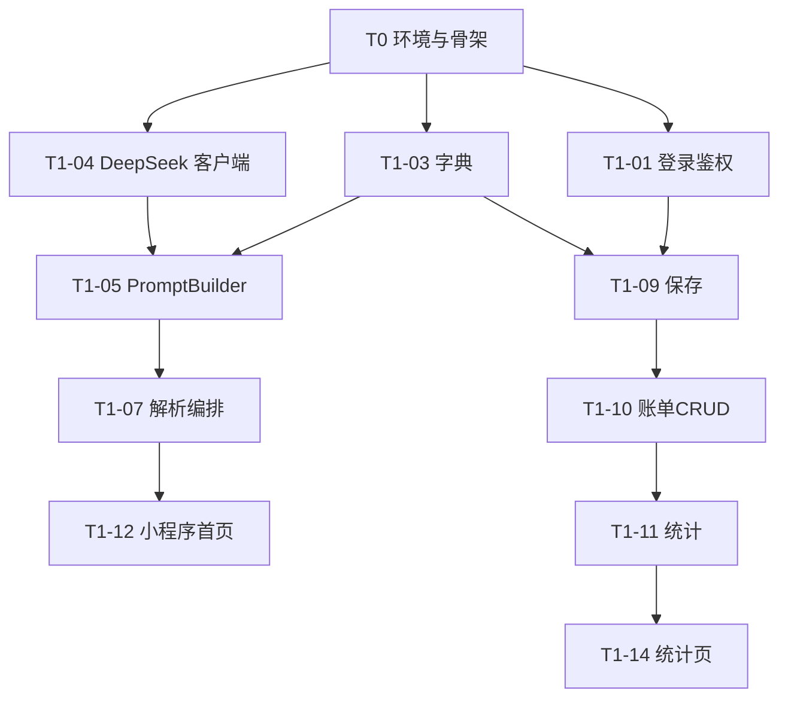

# AI 智能记账小程序 · 开发计划与迭代规划

| 项目 | 内容 |
| --- | --- |
| 项目名称 | AI 智能记账小程序 |
| 文档类型 | 开发计划与迭代规划（Development Plan） |
| 文档版本 | V1.3 |
| 编制日期 | 2026-10-04 |
| 依据文档 | 《01-需求规格说明书》《02-概要设计说明书》《03-数据库设计说明书》《04-接口设计说明书》《05-测试计划》《07-小程序UI与交互设计》 |

## 修订记录

| 版本 | 日期 | 修订说明 |
| --- | --- | --- |
| V1.0 | 2026-10-04 | 首次编制 |
| V1.1 | 2026-10-05 | M1 功能验证通过；V2 范围收敛为 6 项，F-23 语音与 F-62 订阅消息提醒延后 |
| V1.2 | 2026-10-05 | M2 V2 效率增强验收归档：七项功能（模板 / 别名 / 预算 / 导入 / 多轮补全 / 搜索筛选与标签 / 重复检测）编码与测试完成，准出达标（见《05》§6.3） |
| V1.3 | 2026-10-08 | M3 第一批「数据洞察」编码完成：T3-01 趋势报表、T3-02 AI 月报、T3-08 数据导出（F-91）；无新增数据表，接口见《04》§5、§7.4/7.5，小程序端待联调验收 |

---

## 1. 计划目标

用「里程碑 + 任务包」的方式组织开发，明确**做什么、按什么顺序做、依赖什么、交付什么**。具体排期由实际投入强度决定，本文档只约束顺序、依赖与完成标准，不固化日历工期。

---

## 2. 里程碑规划


| 里程碑 | 主题 | 完成标志（Definition of Done） |
| --- | --- | --- |
| M0 | 准备 | 本地环境跑通；数据库建表成功；Spring Boot 骨架与小程序骨架可启动；仓库与分支规范就绪 |
| M1 | V1 核心闭环 | 「一句话 → 确认 → 落库 → 列表 → 统计」全链路可用；P0 用例 100% 通过；NLP 准确率 ≥ 90% |
| M2 | V2 效率增强 | 模板、别名、预算、CSV 导入、多轮补全、搜索筛选与标签、重复检测上线（语音与订阅消息提醒延后）；录入效率与识别准确率显著提升 |
| M3 | V3 数据价值 | AI 月报、趋势报表、共享账本、AA 分账、导出可用 |
| M4 | 上线 | 生产环境部署完成；HTTPS、备份、告警就绪；体验版转正式版 |

> M1 状态（2026-10-05）：主闭环（登录 → 解析 → 保存 → 列表 → 统计）已在微信开发者工具实测通过；P0 用例与 NLP 准确率报告的正式验收归档待补（准出标准见《05》§6.2）。

> M2 状态（2026-10-05）：V2 效率增强七项功能已完成编码与测试验收归档（模板 / 别名 / 预算 / CSV 导入 / 多轮补全 / 搜索筛选与标签 / 重复检测），满足《05》§6.3 准出结论，可进入 M3。

> M3 状态（2026-10-08）：第一批「数据洞察」三件（T3-01 趋势报表、T3-02 AI 月报、T3-08 中 F-91 账单导出）编码完成，后端 `mvn clean compile` 通过，无新增数据表；小程序统计页新增趋势图与 AI 月报卡片、我的页新增导出入口，待真机联调验收。剩余：资金账户（T3-03）、共享账本 / AA / 借贷（T3-04~06）、OCR（T3-07）、备份恢复（F-92）、多币种（T3-09）。

---

## 3. 任务拆解（WBS）

### 3.1 M0 · 准备阶段

| 编号 | 任务 | 产出物 | 依赖 | 完成标准 |
| --- | --- | --- | --- | --- |
| T0-01 | 安装并配置 JDK 17、Maven、MySQL 5.6 | 本地环境 | — | 能启动 Spring Boot 空工程并连上数据库 |
| T0-02 | 创建后端工程骨架（分层包结构） | `backend/` | T0-01 | 启动无报错，健康检查接口可访问 |
| T0-03 | 执行数据库建表与初始化脚本 | `schema.sql`、`data.sql` | T0-01 | 14 张表创建成功，字典数据就绪 |
| T0-04 | 配置 MyBatis-Plus（分页插件、字段自动填充） | 配置类 | T0-02 | `create_time` 自动填充生效 |
| T0-05 | 创建小程序工程骨架与页面路由 | `miniprogram/` | — | 4 个页面可跳转 |
| T0-06 | 初始化 Git 仓库、分支规范与提交规范 | `.gitignore`、规范文档 | T0-02 | 密钥不入库，规范可执行 |
| T0-07 | 申请 DeepSeek API Key、确认小程序 AppID/AppSecret | 配置项 | — | 本地可成功调用一次 Chat Completions |

### 3.2 M1 · V1 核心闭环

| 编号 | 任务 | 对应需求 | 依赖 | 完成标准 |
| --- | --- | --- | --- | --- |
| T1-01 | 微信登录：code2Session + 签发 JWT | F-11 | T0-02 | 可换取 openid，token 可校验 |
| T1-02 | JWT 鉴权拦截器 + 统一响应 + 全局异常 | NF-04 | T1-01 | 未带 token 返回 401 |
| T1-03 | 字典表 CRUD 与 `/api/dict/all` | F-12 | T0-03 | 返回分类与渠道 |
| T1-04 | DeepSeek 客户端封装（超时/重试/异常转换） | F-51 | T0-07 | 可稳定调用并拿到 JSON |
| T1-05 | PromptBuilder（字典动态拼接） | F-51、F-54 | T1-03、T1-04 | Prompt 中只出现字典内取值 |
| T1-06 | ParseResultValidator（校验 + 归一 + 日期补全） | F-54 | T1-05 | 越界值一律归入「其他」 |
| T1-07 | `/api/bill/parse` 解析编排 + 解析日志 | F-21、F-53 | T1-06 | 解析接口可用，日志落库 |
| T1-08 | 解析失败兜底与错误码 | F-52 | T1-07 | 超时/非法 JSON 均返回可用字段 |
| T1-09 | `/api/bill/save`（幂等 + 校验） | F-22 | T1-03 | 重复 requestId 不产生重复记录 |
| T1-10 | 账单列表 / 详情 / 修改 / 删除 | F-31 ~ F-34 | T1-09 | CRUD 全通，越权返回 403 |
| T1-11 | 月度统计与分类占比 | F-41、F-42 | T1-10 | 与手工计算结果一致 |
| T1-12 | 小程序首页：输入 + 解析预览弹窗 + 手动修正 | F-21、F-22 | T1-07、T1-09 | 端到端可完成一次记账 |
| T1-13 | 小程序账单列表页与详情编辑页 | F-31 ~ F-34 | T1-12 | 可查可改可删 |
| T1-14 | 小程序统计页 | F-41、F-42 | T1-11 | 图表与列表正确 |
| T1-15 | V1 集成测试与缺陷修复 | — | T1-14 | 达到《05-测试计划》准出标准 |

### 3.3 M2 · V2 效率增强

| 编号 | 任务 | 对应需求 | 依赖 | 完成标准 |
| --- | --- | --- | --- | --- |
| T2-01 | 语音转文字接入 + `/api/bill/parse/voice`（**延后**，依赖同声传译插件） | F-23 | M1 | 本轮不实施，延后至后续迭代 |
| T2-02 | 模板表 CRUD 与一键记账 | F-24 | M1 | 可增删改模板；一键记账响应 < 200ms 且后端日志无 AI 调用 |
| T2-03 | 多轮补全（`missingFields` 追问） | F-25 | M1 | 缺字段时最多追问 2 轮，第 3 轮降级手动表单，均可完成记账 |
| T2-04 | 别名词典 + 解析前替换（命中可跳过 AI） | F-26 | M1 | 命中别名时直接返回映射结果且不调用 AI；别名可增删改查 |
| T2-05 | CSV 账单导入与批次撤销 | F-28 | M1 | 可预览导入条数与失败明细；整批撤销后无残留账单 |
| T2-06 | 搜索筛选与标签 | F-35、F-36 | M1 | 组合条件筛选结果正确；标签可复用、可按标签筛选 |
| T2-07 | 重复记账检测 | F-37 | M1 | 命中疑似重复时返回 1005 并提示，用户确认（force）后可保存 |
| T2-08 | 预算设置（不含推送） | F-61 | M1 | 可设置月总预算与分类预算，正确展示已用与剩余 |
| T2-09 | V2 回归测试 | — | T2-01 ~ T2-08 | V2 新增用例全部通过，无致命/严重缺陷 |

> F-62 超支订阅消息提醒延后（需先在小程序后台申请订阅消息模板 ID）；本轮预算只做本地视觉预警。

### 3.4 M3 · V3 数据价值与协作

| 编号 | 任务 | 对应需求 | 依赖 |
| --- | --- | --- | --- |
| T3-01 | 趋势报表（月度趋势、同比、环比）✅ 已编码 | F-43 | M2 |
| T3-02 | AI 月度报告（SQL 聚合 + 模型润色）✅ 已编码 | F-44 | T3-01 |
| T3-03 | 资金账户与资产总览 | F-71 | M2 |
| T3-04 | 共享账本与成员权限 | F-81 | M2 |
| T3-05 | AA 分账（分摊明细 + 事务一致性） | F-82 | T3-04 |
| T3-06 | 借贷与应收应付 | F-83 | T3-04 |
| T3-07 | 小票 OCR 记账 | F-27 | M2 |
| T3-08 | 数据导出 ✅（F-91 已编码）与备份恢复（F-92 待做） | F-91、F-92 | M2 |
| T3-09 | 多币种（可选） | F-93 | T3-01 |

### 3.5 M4 · 上线

| 编号 | 任务 | 依赖 | 完成标准 |
| --- | --- | --- | --- |
| T4-01 | 云服务器与域名准备 | — | 域名已备案，HTTPS 证书可用 |
| T4-02 | Docker 镜像构建与部署脚本 | M3 | 一键部署可复现 |
| T4-03 | Nginx 反向代理与 TLS 配置 | T4-01 | 小程序可正常请求 |
| T4-04 | 生产数据库初始化与权限收敛 | T4-01 | 数据库仅内网访问 |
| T4-05 | 密钥环境变量注入 | T4-02 | 镜像中无任何敏感信息 |
| T4-06 | 日志切割与错误告警 | T4-02 | 关键错误可收到通知 |
| T4-07 | 数据备份任务（定期） | T4-04 | 备份可恢复并验证过一次 |
| T4-08 | 小程序合法域名配置与体验版验收 | T4-03 | 体验版全流程通过 |
| T4-09 | 正式版发布 | T4-08 | 审核通过并线上可用 |

---

## 4. 关键依赖与并行建议



**可并行的工作流**

| 工作流 | 内容 | 说明 |
| --- | --- | --- |
| 后端 AI 链路 | T1-04 → T1-08 | 技术风险最高，建议最先启动并尽早验证准确率 |
| 后端业务链路 | T1-01 → T1-03 → T1-09 → T1-11 | 与 AI 链路解耦，可并行 |
| 小程序端 | T0-05 → 页面骨架 → T1-12 ~ T1-14 | 可用 Mock 数据先行开发，后端就绪后联调 |

> **强烈建议**：在 T0 阶段先用少量样本（20 条）手工验证 DeepSeek 的解析效果，确认准确率与成本可接受，再全面投入编码。这是本项目最大的不确定性。

---

## 5. 分支与协作规范

### 5.1 分支模型

| 分支 | 用途 |
| --- | --- |
| `main` | 生产分支，只接受来自 `release` 的合并，每次合并打 tag |
| `develop` | 集成分支，日常合并目标 |
| `feature/<模块>-<简述>` | 功能分支，如 `feature/bill-parse` |
| `fix/<缺陷简述>` | 缺陷修复分支 |
| `release/<版本>` | 发布准备分支 |

### 5.2 提交信息规范

采用 Conventional Commits：

```
<type>(<scope>): <subject>

type：feat | fix | refactor | docs | test | chore | perf
scope：parse | bill | stat | wx | mp | db | config
```

示例：

```
feat(parse): 支持字典外分类自动归一为其他
fix(bill): 修复重复 requestId 导致重复落库的问题
docs(db): 补充 MySQL5.6 索引前缀限制说明
```

### 5.3 提交前检查

- 本地跑通单元测试。
- 无调试代码、无 `System.out.println` 残留。
- 确认未提交任何密钥或本地配置文件。
- 数据库结构变更必须同步更新 `schema.sql` 与《03-数据库设计说明书》。

---

## 6. 代码规范

### 6.1 后端（Java）

| 项 | 规范 |
| --- | --- |
| 分层 | Controller 不写业务；Service 承载业务；Mapper 只做数据访问 |
| 命名 | 类名 UpperCamelCase；方法/变量 lowerCamelCase；常量全大写下划线 |
| DTO 转换 | 禁止把 Entity 直接返回给前端，必须经 DTO |
| 事务 | `@Transactional` 只加在 Service 的写方法上，避免大事务 |
| 异常 | 业务异常统一抛 `BizException`，禁止吞异常 |
| 校验 | 使用 Jakarta Validation 注解，边界清晰 |
| 日志 | 使用 `@Slf4j`；禁止字符串拼接日志，使用占位符；不打印密钥 |
| 金额 | 一律 `BigDecimal`，禁止 `double` |
| 日期 | 使用 `LocalDate` / `LocalDateTime`，禁止 `java.util.Date` |

### 6.2 小程序端（原生）

| 项 | 规范 |
| --- | --- |
| 目录 | 按 `pages/` `components/` `utils/` `api/` `store/` 划分 |
| 请求 | 统一封装 `request`，自动附带 token、统一处理 401 重登与错误提示 |
| 状态 | 页面级状态放 Page data，跨页共享放简易 store |
| 样式 | 使用 rpx；公共样式抽到 `app.wxss` |
| 密钥 | 前端不得出现任何密钥 |
| 交互 | 所有网络请求需有 loading 与失败提示；解析失败必须能切手动填表 |

---

## 7. 环境与工具链

| 类别 | 工具 | 说明 |
| --- | --- | --- |
| 开发 IDE | IntelliJ IDEA / VS Code | 后端 / 小程序 |
| 小程序 | 微信开发者工具 | 开发与调试 |
| 数据库 | Navicat / DBeaver / 命令行 | 建表与数据核对 |
| 接口调试 | Postman / Apifox | 接口联调 |
| 版本控制 | Git | 配合分支规范 |
| 构建 | Maven | 后端打包 |
| 部署 | Docker + Nginx | 生产环境 |
| 日志 | Logback + 文件切割 | 生产可观测 |

---

## 8. 风险登记册

| 编号 | 风险 | 概率 | 影响 | 应对措施 | 责任 |
| --- | --- | --- | --- | --- | --- |
| R1 | NLP 解析准确率不达标 | 中 | 高 | M0 阶段先做小样本验证；Prompt 迭代；建立个人词典；保留结果确认环节 | 后端 |
| R2 | DeepSeek 服务不稳定或超时 | 中 | 中 | 超时重试 + 熔断 + 手动兜底；模型名与超时配置化 | 后端 |
| R3 | 模型名或接口变更 | 中 | 中 | 模型名走配置；关注官方公告；`deepseek-chat`/`reasoner` 已于 2026-07-24 下线，禁止使用 | 后端 |
| R4 | API 调用成本超预期 | 低 | 低 | 别名命中跳过 AI；短时缓存；输入长度限制；用量日志监控 | 后端 |
| R5 | MySQL 5.6 限制导致线上问题 | 低 | 高 | 严格按《03》约定：utf8mb4 + varchar(191) 索引 + 应用层填时间；上线前做 emoji 与时间字段专项测试 | 后端 |
| R6 | 个人主体小程序功能受限 | 中 | 中 | 不使用支付、不做诱导分享；类目选择「工具-其他工具」 | 产品 |
| R7 | 需求蔓延（功能越加越多） | 高 | 中 | 严格按 V1/V2/V3 分期；V1 未达标前不启动 V2 | 产品 |
| R8 | 密钥泄露 | 低 | 极高 | 密钥仅存环境变量；`.gitignore` 覆盖；提交前扫描；泄露立即在控制台重置 | 全员 |
| R9 | 数据丢失 | 低 | 极高 | 定期备份并**验证过恢复流程**；生产库仅内网访问 | 运维 |
| R10 | 需求与实现不一致 | 中 | 中 | 变更须同步更新需求规格与接口文档；需求跟踪矩阵维护 | 全员 |

---

## 9. 交付物清单

| 类别 | 交付物 | 对应阶段 |
| --- | --- | --- |
| 文档 | 需求规格说明书、概要设计、数据库设计、接口设计、小程序 UI 与交互设计、测试计划、开发计划（本套 00 ~ 07） | M0 |
| 数据库 | `schema.sql`（建表）、`data.sql`（初始化字典） | M0 |
| 后端 | Spring Boot 工程（含单元测试） | M1 ~ M3 |
| 小程序 | 原生小程序工程 | M1 ~ M3 |
| 配置 | `application.yml` 模板、`.env.example`（不含真实密钥） | M0 |
| 脚本 | 部署脚本、备份脚本 | M4 |
| 测试 | 测试用例集、NLP 准确率报告、测试报告 | T1 ~ T6 |
| 部署 | Dockerfile、Nginx 配置 | M4 |

---

## 10. 上线检查清单（Release Checklist）

- [ ] 全套文档与代码一致，需求跟踪矩阵无遗漏
- [ ] P0 用例通过率 100%，致命/严重缺陷全部关闭
- [ ] NLP 准确率报告达标（整体 ≥ 90%）
- [ ] 生产数据库已初始化，权限收敛至内网
- [ ] 所有密钥通过环境变量注入，镜像与仓库中无明文
- [ ] HTTPS 生效，小程序合法域名已配置
- [ ] 备份任务已运行并**成功验证过一次恢复**
- [ ] 错误告警可正常触达
- [ ] 强制 HTTPS 后真机全流程回归通过
- [ ] 体验版验收通过，正式版提交审核

---

## 11. 变更与维护

| 事项 | 规则 |
| --- | --- |
| 需求变更 | 更新《01-需求规格说明书》修订记录与需求跟踪矩阵，评审后再进入开发 |
| 接口变更 | 同步更新《04-接口设计说明书》与小程序端调用代码，必要时版本化 |
| 表结构变更 | 增量 SQL 单独成文件并归档，同时更新《03-数据库设计说明书》 |
| 模型或 Prompt 调整 | 记录调整原因与前后准确率对比，避免效果回退无人知晓 |

---

> 文档结束。本套文档（00 ~ 07）构成完整的工程交付文档集。