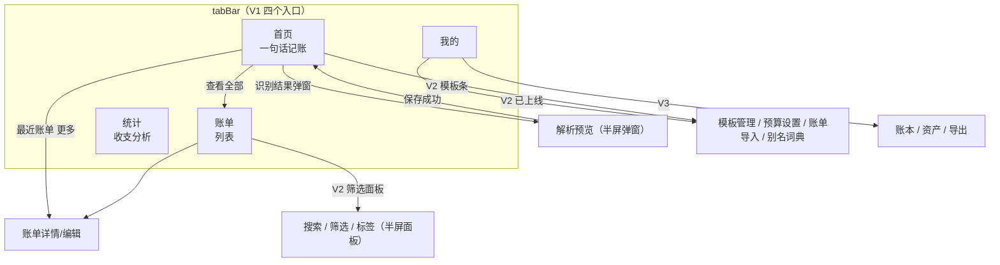
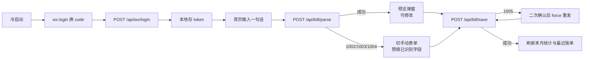
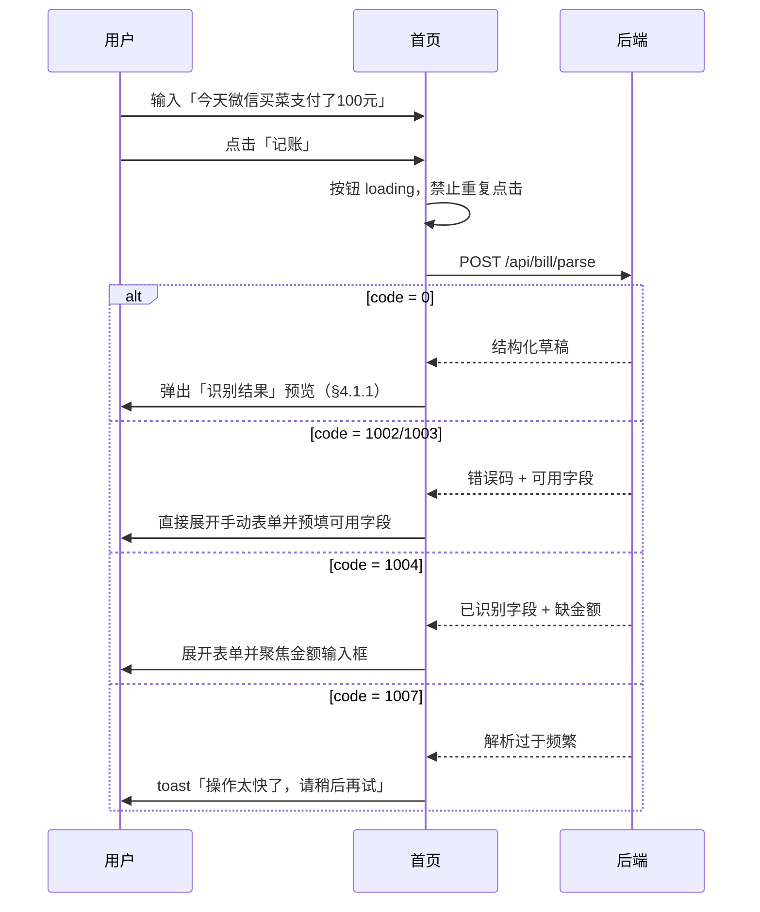
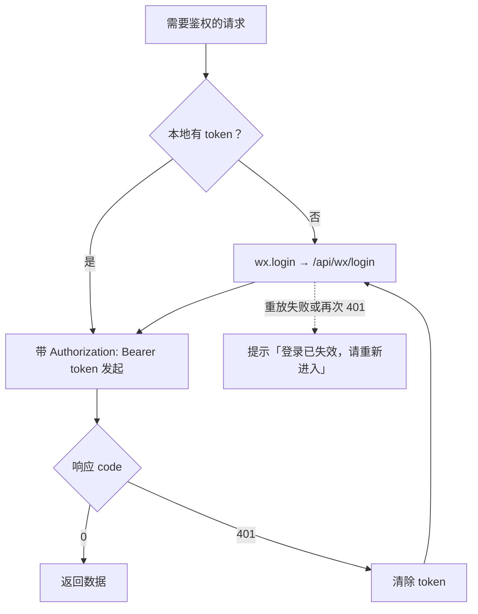

# AI 智能记账小程序 · 小程序 UI 与交互设计说明书（UID）

| 项目 | 内容 |
| --- | --- |
| 项目名称 | AI 智能记账小程序 |
| 文档类型 | UI 与交互设计说明书（UI & Interaction Design） |
| 端 | 原生微信小程序（基础库 ≥ 2.30） |
| 文档版本 | V1.2 |
| 编制日期 | 2026-10-04 |
| 上游文档 | 《01-需求规格说明书》《04-接口设计说明书》《06-开发计划与迭代规划》 |
| 下游文档 | 小程序端代码（`miniprogram/`） |

## 修订记录

| 版本 | 日期 | 修订说明 |
| --- | --- | --- |
| V1.0 | 2026-10-04 | 首次编制，覆盖 V1 全部页面与交互，V2/V3 给出扩展位 |
| V1.1 | 2026-10-04 | UI 风格由「简洁扁平」调整为「奶油马卡龙（可爱风）」：重做 §2 设计规范（配色/圆角/阴影/图标），新增 §2.7 吉祥物设计，同步 §4 页面配色、§5 组件、§8 目录与 §10 验收要点 |
| V1.2 | 2026-10-05 | V2 启动：§4 改为「页面详细设计」并新增 §4.6~§4.9（P-06 模板 / P-07 预算 / P-08 导入 / P-09 别名）与 §4.10 跨页增强（首页模板条、多轮追问、重复确认、列表搜索筛选与标签）；同步 §3 页面清单与导航、§5 组件（新增 `tag-chips` / `filter-panel` / `template-item`）、§9 追溯矩阵、§10 验收 15~20 条；修正 §5 中吉祥物状态与表单态的历史描述 |

---

## 1. 引言

### 1.1 编写目的

把《01-需求规格说明书》中的功能需求与《04-接口设计说明书》中的接口，落到**具体页面、具体控件、具体状态**上，作为小程序端编码与验收的直接依据，避免「边写边拍脑袋」造成的返工与风格不统一。

### 1.2 需求依据

| 本文章节 | 对应需求 | 对应接口 |
| --- | --- | --- |
| §4.1 首页 | F-11、F-12、F-21、F-22、F-51~F-54 | `POST /api/wx/login`、`GET /api/dict/all`、`POST /api/bill/parse`、`POST /api/bill/save` |
| §4.2 列表页 | F-31 | `GET /api/bill/list` |
| §4.3 详情/编辑页 | F-32、F-33、F-34 | `GET /api/bill/detail`、`PUT /api/bill/update`、`DELETE /api/bill/delete` |
| §4.4 统计页 | F-41、F-42 | `GET /api/bill/stat/month`、`GET /api/bill/stat/category` |
| §4.5 我的页 | F-12（V1 极简） | — |
| §4.6 ~ §4.9 V2 四页 | F-24、F-28、F-61、F-26 | `/api/template*`、`/api/bill/import`、`/api/budget`、`/api/alias` |
| §4.10 V2 跨页增强 | F-24、F-25、F-35、F-36、F-37 | `/api/bill/parse`、`/api/bill/save`、`/api/bill/list`、`/api/bill/tag/suggest` |

### 1.3 设计原则

1. **一步记账优先**：首页只做一件事——输入一句话就能记完账，其余功能全部让路。
2. **确认优于自动**：AI 结果一律先预览、可修改，绝不静默落库（呼应 02-§1.2）。
3. **失败必有出路**：任何识别失败都必须能一键切到手动填表，且预填已识别字段（呼应 NF-11、NF-06）。
4. **金额一眼可读**：金额是页面的视觉焦点，字号、字重、颜色优先级最高。
5. **状态可预期**：加载、空态、错误态三类状态全部显式设计，不允许出现白屏。
6. **可爱但有纪律**：可爱感只作用于**装饰层与状态反馈层**（配色、圆角、阴影、图标、吉祥物）；**信息层**（金额、分类、日期、备注）保持高对比、规整、等宽对齐，不得为了可爱牺牲可读性。

---

## 2. 设计规范（Design Tokens）

### 2.1 视觉基调

**风格定位：奶油马卡龙（Cream Macaron）**——奶油白底、柔和暖调、大圆角、极浅暖色阴影，圆润面性图标，并有一只记账吉祥物「萌萌」在关键状态出现。

- 主色沿用微信绿 `#07C160`，保证与微信原生控件（导航栏、toast、modal）协调。
- 奶黄 `#FFC46B` 与蜜桃粉 `#FF9EAB` 仅作**点缀**：标签、图标底、装饰小元素，**不用于承载信息文字**。
- 不使用深色面板、渐变、材质噪声；阴影一律为**大扩散、极浅、暖色调**，营造「软」的观感而非「浮」的观感。
- 允许在**空态、成功反馈、引导**三类场景使用插画/吉祥物位图，其余场景保持克制。

### 2.2 色彩规范

| 语义 | 变量名 | 色值 | 用途 |
| --- | --- | --- | --- |
| 主色 | `--color-brand` | `#07C160` | 仅用于图形与底色：柱状图、圆点、进度填充、徽标底 |
| 主色-文字 | `--color-brand-text` | `#048030` | 主色系的可读文字色：选中标签文字、品牌小标题 |
| 主色-实心 | `--color-brand-strong` | `#048030` | 主按钮底色、白字按钮（白字压在上面对比度 ≥ 4.5:1） |
| 主色-按下 | `--color-brand-active` | `#037027` | 按钮按下态 |
| 主色-浅底 | `--color-brand-light` | `#E8F8EF` | 选中标签底、图标底 |
| 支出 | `--color-expense` | `#FF7B84` | 支出金额（大字号/加粗场景） |
| 支出-强 | `--color-expense-strong` | `#D03D3A` | 支出小字号文字，保证对比度 |
| 收入 | `--color-income` | `#07C160` | 收入金额（大字号场景） |
| 收入-文字 | `--color-income-text` | `#048030` | 收入小字号文字 |
| 点缀-奶黄 | `--color-accent-yellow` | `#FFC46B` | 标签底、图标底、装饰 |
| 点缀-蜜桃粉 | `--color-accent-pink` | `#FF9EAB` | 标签底、图标底、装饰 |
| 点缀-薄荷 | `--color-accent-mint` | `#8ED9C0` | 标签底、次级图标 |
| 警示 | `--color-warning` | `#FF976A` | 预算预警底色、低置信度提示底 |
| 警示-文字 | `--color-warning-strong` | `#B4552B` | 警示小字号文字与徽标底 |
| 信息 | `--color-info` | `#6BB6FF` | 链接、次要按钮底 |
| 信息-文字 | `--color-info-strong` | `#1F6FBF` | 信息类文字与实心按钮底 |
| 主要文字 | `--color-text` | `#1A1A1A` | 标题、金额 |
| 次要文字 | `--color-text-sub` | `#666666` | 字段名、副标题 |
| 辅助文字 | `--color-text-hint` | `#6B6B6B` | 占位符、时间、计数 |
| 分割线 | `--color-border` | `#F0E6DC` | 列表分隔、卡片描边（暖调） |
| 内嵌区底色 | `--color-bg-muted` | `#FFF4E9` | 卡片内次级区块、分组容器 |
| 页面底色 | `--color-bg-page` | `#FFF9F2` | 页面背景（奶油白） |
| 卡片底色 | `--color-bg-card` | `#FFFFFF` | 卡片、弹窗、输入框 |

**配色约束**

1. 承载信息的语义色同时最多 2 种：支出 `--color-expense` + 收入 `--color-income`。
2. 点缀色（奶黄/蜜桃粉/薄荷）**只做底色与装饰**；如在其上放文字，文字必须为 `--color-text` 或更深的同色系，禁止白字压在点缀色上（对比度不足）。
3. 遮罩统一 `rgba(74,53,42,.35)`（暖调深色，替代纯黑遮罩，避免奶油底上出现灰脏感）。
4. 所有颜色必须通过 CSS 变量引用，禁止在页面/组件内写死色值。
5. **亮绿 `#07C160` 只承担图形与底色，不承载文字**。需要绿色文字时一律用 `--color-brand-text` / `--color-income-text`（`#048030`）；白字按钮的底色用 `--color-brand-strong`。原因：`#07C160` 压在白色或浅绿底上对比度仅 1.4~2.3:1，达不到可读下限。
6. **每个语义色都有「图形版 / 文字版」两支**（`-strong`、`-text` 后缀）。新增语义色时必须同时提供文字版，且文字版对白底对比度 ≥ 4.5:1。

### 2.3 字体与字号

**字体策略（重要）**

- V1 **不引入自定义字体**。小程序加载网络字体需 `wx.loadFontFace` + HTTPS 字体文件，存在首屏闪烁与包体成本，性价比低。
- 可爱感由**配色、圆角、阴影、图标、插画**承担，不依赖圆体字。
- 中文使用系统字体（iOS：PingFang SC；Android：系统字体）；数字使用 `DIN Alternate` 回退系统字体，保证金额等宽对齐。
- V2 若确有需要，再通过 `wx.loadFontFace` 引入圆体并做降级（加载失败回落系统字体）。

| 层级 | 字号 | 字重 | 行高 | 用途 |
| --- | --- | --- | --- | --- |
| 超大数字 | 72rpx | 600 | 1.2 | 统计页月度主金额 |
| 大数字 | 48rpx | 600 | 1.2 | 列表项金额、预览弹窗金额 |
| 页面标题 | 40rpx | 600 | 1.4 | 页面主标题 |
| 卡片标题 | 32rpx | 600 | 1.4 | 卡片内标题、分类名 |
| 正文 | 30rpx | 400 | 1.5 | 输入框文字、备注 |
| 小正文 | 28rpx | 400 / 600 | 1.4 | 表单控件值、按钮文字、小节标题 |
| 次要 | 26rpx | 400 | 1.4 | 字段名、日期 |
| 辅助/标签 | 24rpx | 400 | 1.3 | 计数、说明文字、标签文字 |
| 最小值 | 22rpx | 400 | 1.3 | **仅限**底部版权、免责说明、版本号 |

> 任何**承载信息**的文字不小于 24rpx；22rpx 只允许出现在版权/免责/版本号等非信息性文字上。
> 金额一律使用 `font-variant-numeric: tabular-nums`（`.num` 类）。
> 禁止用 `transform: scale()` 去压缩文字来塞进布局 —— 那会让实际渲染字号小于名义字号。放不下就改文案或换布局。

### 2.4 间距、圆角、阴影与描边

| 项 | 值 | 说明 |
| --- | --- | --- |
| 间距梯度 | 4 / 8 / 12 / 16 / 20 / 24 / 32 / 48 rpx | 4rpx 网格 8 档，禁止出现阶梯外的值 |
| 页面左右边距 | 32rpx | 全页面统一 |
| 卡片内边距 | 32rpx | 上下 24rpx 可酌情 |
| 卡片圆角 | 32rpx | 列表项、卡片、分组容器 |
| 弹窗圆角 | 32rpx | 半屏弹窗顶部圆角 |
| 输入框圆角 | 24rpx | 输入区、选择器触发区 |
| 按钮圆角 | 999rpx（胶囊） | 主按钮与次按钮统一胶囊形 |
| 标签/徽标圆角 | 999rpx | 分类标签、状态标签 |
| 卡片阴影 | `--shadow-card` = `0 8rpx 24rpx rgba(255,158,171,.16)` | 所有卡片 |
| 浮层阴影 | `--shadow-float` = `0 -8rpx 32rpx rgba(255,158,171,.18)` | 底部半屏弹窗、选择面板 |
| 主按钮阴影 | `--shadow-btn` = `0 8rpx 20rpx rgba(7,193,96,.24)` | 仅主按钮，强化可点性 |
| 分割线 | 1px（`0.5px` 细分线） | 颜色 `--color-border` |
| 最小点击热区 | 88rpx × 88rpx | 所有可点元素，禁止小于此值 |

| 圆角只有 24 / 32 / 999 三档，阴影只有上述 3 个变量，禁止在页面里临时取值。

> **豁免**：吉祥物「萌萌」等插画组件内部的形状几何（云朵嘴弧度、钱包尾巴、爱心、雨伞）用 `em` 等比绘制，不受三档圆角与本表间距约束 —— 它们不是界面容器，是插图本身。

**88rpx 热区的落地方式**（三种，按控件形态选一种，不要改小字号去凑）

1. **块级按钮 / 分段项 / 芯片**：直接 `min-height: 88rpx`（原来的 `height: 76rpx`、`min-height: 60rpx` 之类一律抬到 88）。分段控件因此从 76/64 变高，视觉上更厚一点，属预期。
2. **纯文字小按钮**（`关闭` / `清空` / `查看更多` 这类只有文字没有底色的元素）：`display: inline-flex; align-items: center; min-height: 88rpx;` —— 字号、颜色、位置都不变，只是可点高度变大。父级多为 `align-items: center` 的标题行，行高会被自然撑到 88rpx，不需要额外抵消。
3. **嵌在胶囊内部的删除符号**（`✕`，如 `.pill__del`）：`min-height: 88rpx` 会把外层胶囊一起撑高，必须配 `margin: -24rpx 0` 抵消掉多出来的高度，`min-height` 与负 margin 成对出现，缺一不可。

> 判定可否点的口径：WXML 上带 `bindtap` / `catchtap` 的元素全部计入。全屏遮罩（`position: fixed` 且四边贴 0）、`height: 100%` 继承父高的子项、`canvas` / `image` 不计。

### 2.5 图标与插画

- 图标统一使用**圆润面性图标**（Rounded Filled），端点与转角带圆头，尺寸 40rpx / 48rpx / 56rpx 三档。
- 分类图标：V1 用「**彩色圆形底 + 分类图标（或分类名首字）**」方案，圆形底从点缀色板中按分类序位取色；V2 替换为正式圆润图标集。
- 允许位图/插画的**仅限三处**：空态插图、保存成功反馈、我的页吉祥物。
- 插画一律使用吉祥物「萌萌」（见 §2.7），不得混入风格不一致的第三方素材。
- 图标与插画资源放在 `assets/icons/`、`assets/mascot/`，导出 2 倍与 3 倍图；SVG 优先。
- **禁止用 emoji 充当图标或插画**（📷 🌟 💡 🐻 等）。原因有三：字形与配色随操作系统/机型变化（同一个 emoji 在 iOS、Android、鸿蒙上长相完全不同）、无法跟随主题色、视觉重量不可控。需要情绪表达时用吉祥物组件，需要图标时等 `assets/icons/` 就位；两者都没有的场景用**纯文字 + 字重/颜色**表达层级。
- `✓` `✕` `▾` `›` `·` 这类**几何符号字形**可以保留 —— 它们是排版符号，不是插画，且各端字形差异极小。

### 2.6 适配与安全区

| 项 | 规则 |
| --- | --- |
| 单位 | 一律 `rpx`，仅在需要 1px 描边时用 `px` |
| 底部安全区 | 底部固定按钮使用 `padding-bottom: env(safe-area-inset-bottom)` |
| 横屏 | 不支持，`pageOrientation` 固定竖屏 |
| 长文本 | 备注、原始输入统一 `overflow-wrap: break-word`，禁止撑破容器 |
| 弹窗高度 | 半屏弹窗最大 `78vh`，超出内部滚动，**禁止页面级嵌套滚动** |

**半屏弹窗骨架**（九个贴底浮层统一按这套写，缺一条就会出现"键盘弹起后按钮被顶出屏幕"）

```css
.sheet__panel {
  display: flex;
  flex-direction: column;
  max-height: 78vh;      /* ① 外壳必须有高度上限 */
}
.sheet__header { flex: none; }                          /* ② 头尾不参与压缩 */
.sheet__body   { flex: 1; max-height: 58vh; }           /* ③ 身体吃掉剩余高度并自己封顶 */
.sheet__footer { flex: none; }
.sheet__safe   { flex: none; height: env(safe-area-inset-bottom); }
```

```html
<scroll-view class="sheet__body" scroll-y>…</scroll-view>  <!-- ④ 身体必须是 scroll-view -->
```

- ④ 用普通 `<view>` 时 `max-height` 只会把内容裁掉，滚不动 —— 这是最容易漏的一步。
- 安全区占位（`.safe-bottom` / `.sheet__safe`）必须 `flex: none`，否则全面屏上会被 flex 压成 0。

### 2.7 吉祥物设计：「萌萌」

**定位**：软萌、治愈、会帮用户「吃掉」账单烦恼的小记账精灵。只负责**情绪反馈与引导**，不承载信息，不遮挡操作。

**角色规范**

| 项 | 规范 |
| --- | --- |
| 名称 | 萌萌（可改名，改动需同步本节与资源目录） |
| 形象 | **云朵身体 + 硬币光环 + 钱包尾巴**：软绵绵的云朵形身体，圆滚滚、无攻击性；头顶一枚小硬币光环；尾巴是一只迷你小钱包；手脚短短圆圆，不做复杂肢体 |
| 色板 | 身体 `#FFFEFB` 奶油白、轮廓线 `#B5AB9F` 浅咖啡灰、眼睛 `#5B4B47` 深咖啡（黑豆眼 + 高光）、腮红 `#FFD6DC` 浅粉、硬币光环 `#FFD58A` 奶油黄、钱包尾巴 `#8DE0B4` 浅薄荷绿、小爱心点缀 `#FFB3A7` 浅珊瑚红 |
| 令牌 | 上述色值统一收进 `app.wxss` 的 `--mascot-body / --mascot-line / --mascot-eye / --mascot-blush / --mascot-coin / --mascot-wallet / --mascot-heart` |
| 尺寸 | 96rpx（小·角标） / 160rpx（中·空态） / 240rpx（大·引导与我的页） |
| 格式 | SVG 优先，PNG 导出 2x/3x；V1 由 `mascot` 组件用 WXSS 代码绘制（`mascot.js` 的 `USE_BITMAP = false`，默认不请求 PNG，避免素材缺失时控制台报 500）；放入 `assets/mascot/mengmeng-*.png` 后把该值改为 `true` 即自动优先使用位图 |
| 动画 | 单次反馈动画时长 ≤ 600ms；光环呼吸 / 挥手 / 思考点为低频循环，禁止高频闪烁；遵循系统「减弱动态效果」设置 |

**表情表**

| 表情 | 含义 | 使用场景 |
| --- | --- | --- |
| `·ᴗ·` 微笑 | 正常状态 | 默认展示 |
| `·ω·` 期待 | 等待输入 | 首页输入框旁 |
| `·_·` 疑惑 | 识别不确定 | AI 置信度低 |
| `>ω<` 开心 | 保存成功 | 记账成功提示 |
| `·o·` 惊讶 | 大额支出 | 金额较大时（≥ ¥500） |
| `;_;` 委屈 | 空状态 | 暂无账单 |
| `✧ω✧` 闪亮 | 统计完成 | 月度总结页 |

**动作表**

| 动作 | 说明 | 使用场景 |
| --- | --- | --- |
| 站立挥手 | 欢迎用户 | 启动页、我的页 |
| 抱着硬币 | 存钱 | 统计页、结余增加 |
| 抱着小账本 | 认真记账 | 首页、解析中 |
| 蒙眼害羞 | 看到大额支出 | 异常金额提示 |
| 打滚开心 | 记账成功 | 保存成功反馈 |
| 撑伞躲雨 | 网络异常 | 失败页、断网页 |
| 抱臂思考 | AI 解析中 | loading 状态 |

**八个状态与出现位置（仅限以下位置，不得随意新增）**

| 状态值 | 表情 + 动作 | 出现位置 | 配合文案 |
| --- | --- | --- | --- |
| `idle` | 微笑 + 站立挥手 | 我的页（240rpx）、启动欢迎 | 无 |
| `expect` | 期待 + 抱小账本 | 首页输入区角标（96rpx）、降级表单顶部 | 无 /「没太听懂，你直接填一下？」 |
| `thinking` | 疑惑 + 抱臂思考 | 首页输入区角标（解析中替换 `expect`） | 「萌萌正在理解…」 |
| `success` | 开心 + 打滚开心 | 保存成功：吃掉输入文字 + toast | 「烦恼已被萌萌吃掉啦」 |
| `wow` | 惊讶 + 蒙眼害羞 | 识别出 ≥ ¥500 的大额支出 | 无 |
| `empty` | 委屈 | 首页最近账单、列表页、统计页空态（160rpx） | 「还没有账单，试着记一笔吧」 |
| `offline` | 委屈 + 撑伞躲雨 | 网络异常（展示 2.4s 后自动收起） | 网络错误 toast |
| `shine` | 闪亮 + 抱着硬币 | 统计页结余卡片右上角（96rpx） | 无 |

**「吃掉账单烦恼」交互（V1 落地）**

保存成功后，首页输入框内的文字向萌萌方向收缩消失（`.hero__textarea.is-eaten`，620ms），萌萌同时切 `success` 态并冒出「啊呜～」气泡，动画结束后再清空输入框。这是定位中「吃掉烦恼」的唯一具象交互，仅首页触发。

**约束**

1. 吉祥物**不得出现在**金额区域或表单字段行（统计页 `shine` 为结余卡片右上角角标，是唯一例外，且必须避开金额数字）。
2. 同一屏最多出现 1 个吉祥物。
3. 空态（`empty`）取代 V1.0 的「线性图标 + 文案」方案；若插画加载失败，必须降级为纯文案 + 主按钮，不允许白屏。
4. V1 吉祥物由 `mascot` 组件以纯 WXSS 绘制（根节点 `font-size = size`，内部尺寸用 `em` 等比缩放），无需任何图片素材；后续接入 PNG 素材时组件自动切换，无需改代码。
5. 状态命名以本表为准；历史命名 `sorry` 由组件内部映射为 `expect`；任何新增状态必须同步本节与 `mascot.js` 的 `STATES`。

---

## 3. 信息架构与页面地图

### 3.1 页面清单

| 编号 | 页面 | 路径 | tabBar | 版本 | 需求 |
| --- | --- | --- | --- | --- | --- |
| P-01 | 首页 · 一句话记账 | `pages/index/index` | ✅ | V1 | F-21、F-22 |
| P-02 | 账单列表 | `pages/bill/list/list` | ✅ | V1 | F-31 |
| P-03 | 账单详情 / 编辑 | `pages/bill/detail/detail` | — | V1 | F-32~F-34 |
| P-04 | 统计 | `pages/stat/stat/stat` | ✅ | V1 | F-41、F-42 |
| P-05 | 我的 | `pages/mine/mine/mine` | ✅ | V1（极简） | F-12 |
| P-06 | 模板管理 | `pages/template/list/list` | — | V2 | F-24 |
| P-07 | 预算设置 | `pages/budget/budget/budget` | — | V2 | F-61 |
| P-08 | 导入账单 | `pages/import/import/import` | — | V2 | F-28 |
| P-09 | 别名词典 | `pages/alias/alias/alias` | — | V2 | F-26 |
| P-10 | AI 月报 | `pages/report/report/report` | — | V3 | F-44 |
| P-11 | 账本 / 协作 | `pages/book/*` | — | V3 | F-81~F-83 |
| P-12 | 资产总览 | `pages/asset/asset/asset` | — | V3 | F-71 |

> **V2 落地说明**：P-06 ~ P-09 四页在 V2 实现（详细设计见 §4.6 ~ §4.9）；**F-35 搜索筛选不新增页面**，作为 P-02 列表页内的半屏筛选面板实现（见 §4.10 ④）；F-23 语音、F-62 超支推送因依赖外部能力（同声传译插件 / 订阅消息模板 ID）**本轮不做**。

### 3.2 导航结构



### 3.3 主闭环路径（V1 核心）



---

## 4. 页面详细设计

### 4.1 P-01 首页 · 一句话记账（核心页）

**页面目标**：让用户在 5 秒内完成一次记账。

**入口**：小程序启动默认页、tabBar 第一个。

**布局结构**

```
┌───────────────────────────────────┐
│  记一笔                            │  ← 导航栏（微信原生）
├───────────────────────────────────┤
│ ┌───────────────────────────────┐ │
│ │ 今天微信买菜支付了100元    (萌萌)│ │  ← 输入区（textarea，最多 200 字）
│ │                               │ │    右上角祥物角标 96rpx
│ └───────────────────────────────┘ │
│  0/200                  [ 🎤 V2 ] │  ← 计数 + 语音占位
│                                   │
│         ┌───────────────┐         │
│         │     记账       │         │  ← 主按钮（胶囊，主色 + 按钮阴影）
│         └───────────────┘         │
├───────────────────────────────────┤
│ ╭── 奶油卡片 ───────────────────╮ │
│ │  本月支出  ¥3,250.50   共 62 笔│ │  ← 迷你统计条（可点进统计页）
│ │  本月收入  ¥8,000.00   结余 4,749.50│
│ ╰───────────────────────────────╯ │
├───────────────────────────────────┤
│  最近账单                    更多 >│
│  ╭──────────────────────────────╮ │
│  │ (买) 买菜餐饮  微信    -100.00│ │  ← 彩色圆标 + 金额
│  │ (交) 交通出行  支付宝   -20.00│ │
│  ╰──────────────────────────────╯ │
│  ...（最多 5 条）                  │
└───────────────────────────────────┘
```

**元素清单**

| 元素 | 说明 | 交互 |
| --- | --- | --- |
| 输入框 | `textarea`，`maxlength=200`，自动聚焦，圆角 24rpx | 输入即显示字数；为空时主按钮置灰 |
| 吉祥物角标 | 输入区右上角 96rpx，待机/解析中两态（§2.7 ①②） | 不可点击 |
| 字数计数 | `已输入/200`，超过 180 变警示色 | 超 200 由 `maxlength` 截断 |
| 语音按钮 | V1 置灰 + 「即将上线」toast | V2 接入 |
| 主按钮「记账」 | 胶囊形，输入非空才可点，点击后进入 `loading` | 防重复点击（见 §6.6） |
| 迷你统计条 | 调用 `stat/month` 取当月 | 点击跳统计页 |
| 最近账单 | 调用 `list` 取 5 条 | 点击跳详情；「更多」跳列表页 |

**交互流程**



**4.1.1 解析预览（半屏弹窗）**

```
┌───────────────────────────────────┐
│  识别结果              置信度 95%  │  ← 顶部 32rpx 圆角
│  ⚠ 识别把握较低，请核对后保存      │  ← confidence < 0.5 才显示
├───────────────────────────────────┤
│  金额    ¥ [ 100.00          ]     │
│  类型      ( ● 支出 )  ( 收入 )    │  ← 选中态用主色浅底 + 主色胶囊
│  渠道      [ 微信              > ] │
│  分类      [ 买菜餐饮          > ] │
│  日期      [ 2026-10-04        > ] │
│  备注      [ 日常买菜消费       ]  │
├───────────────────────────────────┤
│   [ 取消 ]          [ 保存 ]      │  ← 均胶囊形
└───────────────────────────────────┘
```

**规则**

| 项 | 规则 |
| --- | --- |
| 弹出时机 | `parse` 返回 `code=0` 时 |
| 预填 | 全部字段来自 `parse` 响应；`payChannelCode` / `categoryCode` 用中文名展示 |
| 可编辑 | 六个字段全部可改（`needConfirm` 恒为 true，必须人工确认） |
| 低置信度 | `confidence < 0.5` 时，弹窗顶部显示警示条，且低置信字段描边警示色 |
| 缺失字段 | `missingFields` 中的字段加警示描边并在右侧显示「待补充」 |
| 取消 | 关闭弹窗，保留输入框文本，不落库 |
| 保存 | 生成 `requestId`（UUID v4）后调 `save`；成功后关闭弹窗、清空输入、显示吉祥物「成功」态 + toast「已记账」、刷新统计与最近账单 |
| 保存失败 1005 | 弹 `modal`「疑似重复，是否继续保存？」→ 确认则以 `force=true` + **新** `requestId` 重发 |
| 保存失败其他 | 保留弹窗内容，toast 错误信息，允许重试（`requestId` 复用，保证幂等） |

**4.1.2 手动填表（降级表单）**

解析失败时不弹窗，直接在首页展开一个表单区块，顶部放吉祥物「抱歉」态（96rpx）与文案「没太听懂，你直接填一下？」，字段与预览弹窗一致，**已识别字段预填**，未识别字段留空并标红。底部固定胶囊形「保存」按钮，`amount` 为空或 ≤ 0 时不可提交。

**异常与状态**

| 状态 | 表现 |
| --- | --- |
| 初始 | 输入框空、主按钮置灰、吉祥物待机态、最近账单为加载骨架 |
| 输入中 | 主按钮激活 |
| 解析中 | 主按钮变「识别中…」+ loading 图标；输入框只读；吉祥物切「思考」态 + 文案「萌萌正在理解…」 |
| 解析成功 | 弹预览窗 |
| 保存成功 | 吉祥物「成功」态 + toast「已记账啦」 |
| 解析失败 | 吉祥物「抱歉」态 + 展开手动表单 + 顶部 toast 原因 |
| 本月无账单 | 迷你统计条显示 `¥0.00`，最近账单显示空态（吉祥物「空态」+「还没有账单，试着记一笔吧」） |
| 网络异常 | toast「网络异常，请检查网络后重试」，按钮恢复可点 |

---

### 4.2 P-02 账单列表页

**页面目标**：按时间倒序浏览、筛选、定位账单。

**布局结构**

```
┌───────────────────────────────────┐
│  账单                              │
├───────────────────────────────────┤
│  [ 2026-10 ▾ ]   [ 全部 ▾ ]  [🔍]  │  ← 月份 / 收支类型 / 搜索（V2 展开）
├───────────────────────────────────┤
│  10-04  周六            支出 120.50│  ← 日期分组头 + 当日小计
│  ╭──────────────────────────────╮ │
│  │ (买) 买菜餐饮  微信  -100.00 │ │  ← 白色卡片 + 32rpx 圆角 + 浅阴影
│  │ (交) 交通出行  支付宝 -20.50 │ │
│  ╰──────────────────────────────╯ │
│  10-03  周五            支出 350.00│
│  ╭──────────────────────────────╮ │
│  │ (购) 购物消费  微信  -350.00 │ │
│  ╰──────────────────────────────╯ │
│         —— 已加载全部 ——           │
└───────────────────────────────────┘
```

**规则**

| 项 | 规则 |
| --- | --- |
| 排序 | 后端返回 `record_date DESC, id DESC`，前端按日期分组展示 |
| 分组 | 同一天归为一组，组头显示「MM-dd 周X」+ 当日收支小计；组内容器底 `--color-bg-muted` |
| 分页 | 首次 `size=20`；向上滚动触底加载下一页；底部显示「加载中…/已加载全部」 |
| 下拉刷新 | 重置到第 1 页 |
| 月份筛选 | 默认当月；选择器提供近 12 个月 |
| 收支筛选 | 全部 / 支出 / 收入 |
| 搜索 | V2 开放（关键词匹配备注与原始文本） |
| 点击条目 | 跳 P-03 详情 |
| 空态 | 吉祥物「空态」态（160rpx）+「本月还没有账单」+ 胶囊「去记一笔」按钮（跳首页） |
| 首屏 | 使用骨架屏（3 个占位卡片），不使用全屏 loading |

---

### 4.3 P-03 账单详情 / 编辑页

**页面目标**：查看完整信息（含 AI 原始输入），并可直接修改、删除。

**布局结构**

```
┌───────────────────────────────────┐
│  < 返回      账单详情              │
├───────────────────────────────────┤
│          - ¥100.00                 │  ← 顶部大金额（支出红 / 收入绿）
│          买菜餐饮 · 微信            │
├───────────────────────────────────┤
│  ╭── 奶油卡片 ───────────────────╮ │
│  │ 金额        [ 100.00        ]│ │
│  │ 类型        (● 支出)( 收入 )  │ │
│  │ 渠道        [ 微信           >]│ │
│  │ 分类        [ 买菜餐饮       >]│ │
│  │ 日期        [ 2026-10-04     >]│ │
│  │ 备注        [ 日常买菜消费    ]│ │
│  │ 标签        [ 出差 × ] [+ 添加]│ │  ← V2 开放
│  ╰──────────────────────────────╯ │
├───────────────────────────────────┤
│  AI 原始输入                        │
│  「今天微信买菜支付了100元」        │
│  解析置信度 95% · 来源 文本         │
│  创建于 2026-10-04 12:30:11         │
├───────────────────────────────────┤
│  [        保存修改        ]        │  ← 胶囊主按钮
│  [        删除账单        ]        │  ← 次要危险按钮（描边，不填充）
└───────────────────────────────────┘
```

**规则**

| 项 | 规则 |
| --- | --- |
| 数据来源 | `GET /api/bill/detail?billId=`，含 `recordText`、`updateTime` |
| 编辑入口 | 页面默认只读态，点击「编辑」或任一字段进入编辑态；或直接可编辑（推荐直接可编辑，减少一次点击） |
| 保存 | `PUT /api/bill/update`，仅提交发生变化的字段；成功后 toast「已保存」并回传列表页刷新 |
| 分类联动 | 切换「收支类型」后，分类选择器只展示对应类型的分类；若原分类不匹配则清空要求重选 |
| 金额校验 | 前端拦截 ≤ 0 与非数字，提示「请输入正确的金额」 |
| 删除 | 点击后 `modal` 二次确认「删除后不可恢复，确定删除？」→ `DELETE /api/bill/delete` |
| 越权/不存在 | 返回 403/404 时 toast 并自动返回上一页 |
| 已删除后返回 | 列表页 `onShow` 重新拉取，保证数据一致 |

> 本页**不出现吉祥物**：详情/编辑是信息密集页，装饰元素会让位给字段与金额。

---

### 4.4 P-04 统计页

**页面目标**：一屏看懂本月钱花在哪。

**布局结构**

```
┌───────────────────────────────────┐
│  统计          [ 2026-10 ▾ ]       │
├───────────────────────────────────┤
│  ╭── 奶油卡片（主色浅底渐变到白）─╮ │
│  │  本月结余                    │ │
│  │  ¥4,749.50                   │ │  ← 72rpx 超大数字
│  │  收入 ¥8,000.00  支出 ¥3,250.50│ │
│  ╰──────────────────────────────╯ │
├───────────────────────────────────┤
│  支出构成（共 ¥3,250.50）          │
│         ╭───────╮                  │
│        ╱  环形图  ╲                 │  ← 环形图 + 中心总额
│        ╲         ╱                  │
│         ╰───────╯                  │
│  ● 买菜餐饮  ¥1,200.00   36.92%    │
│  ● 交通出行  ¥650.50     20.01%    │
│  ● 购物消费  ¥500.00     15.38%    │
│  ● 其他      ¥900.00     27.69%    │
├───────────────────────────────────┤
│  [ 支出 ]  [ 收入 ]                │  ← 胶囊分段控件，选中态主色浅底
└───────────────────────────────────┘
```

**规则**

| 项 | 规则 |
| --- | --- |
| 数据来源 | `stat/month` + `stat/category`（`billType=0/1`） |
| 月份切换 | 默认当月，可切近 12 个月 |
| 结余口径 | `balance = income - expense`，与后端一致，前端不再计算 |
| 占比展示 | 后端 `ratio` 为 4 位小数，前端转百分比保留 1~2 位；**占比合计尾差补偿**：最大项吸收误差，确保合计 100% |
| 图表 | 使用原生 `canvas` 或轻量图表（`ec-canvas` / 自绘），不得引入 > 200KB 的图表库 |
| 环形图样式 | 环宽 32rpx，扇区间留 2rpx 白色间隙，中心显示总额（数字 40rpx / 600） |
| 无数据 | 吉祥物「空态」态（160rpx）+「本月还没有支出记录」 |
| 明细列表 | 按金额倒序；点击某分类可跳转到「列表页并带上该分类筛选」（V2 开放） |
| 颜色 | 环形容器使用固定分类色板，顺序与列表一致，最多 6 色 + 「其他」暖灰 |

**分类色板（固定顺序，与奶油底协调）**

| 序号 | 色值 | 说明 |
| --- | --- | --- |
| 1 | `#07C160` | 主色绿 |
| 2 | `#FFC46B` | 奶黄 |
| 3 | `#FF9EAB` | 蜜桃粉 |
| 4 | `#6BB6FF` | 天空蓝 |
| 5 | `#A88BEB` | 薰衣草紫 |
| 6 | `#7ED9A6` | 薄荷绿 |
| 其他 | `#D9D2CB` | 暖灰 |

---

### 4.5 P-05 我的页（V1 极简）

V1 只放三样东西，不做任何多余功能；**V2 起下方入口区变为可用**：

```
┌───────────────────────────────────┐
│  我的                              │
├───────────────────────────────────┤
│  (萌萌 240rpx)  ● 微信用户          │  ← 吉祥物大图 + 昵称
│                 累计记账 128 笔     │
├───────────────────────────────────┤
│  [ 模板管理 ]                    >  │
│  [ 预算设置 ]                    >  │
│  [ 账单导入 ]                    >  │
│  [ 别名词典 ]                    >  │
│  [ 数据导出 ]         V3 即将上线   │
├───────────────────────────────────┤
│  版本 1.1.0                        │
└───────────────────────────────────┘
```

**规则**：V3 入口（数据导出）仍以置灰项展示（点击 toast「即将上线」）；V2 四个入口已可用，`wx.navigateTo` 跳转 §4.6 ~ §4.9。

---

### 4.6 P-06 模板管理页（V2）

入口：我的页 → 模板管理。非 tabBar 页，`wx.navigateTo` 跳转。

```
┌───────────────────────────────────┐
│  ← 模板管理                        │
├───────────────────────────────────┤
│  [ + 新建模板 ]                    │
├───────────────────────────────────┤
│  ┌─────────────────────────────┐  │
│  │ ☕ 早餐               ¥15.00 │  │
│  │ 微信 · 买菜餐饮   已用 12 次 │  │
│  │                     [记一笔] │  │
│  └─────────────────────────────┘  │
└───────────────────────────────────┘
```

**规则**

1. 列表按接口既定顺序（`useCount DESC, sortNo ASC`）；首屏骨架屏，空态用 `empty-state`（`mascotState="empty"`，文案「还没有模板，把常记的账存成模板吧」）。
2. 「记一笔」→ `POST /api/template/use`，成功后 toast「已记一笔」并在顶部浮出「撤销」条（3 秒，调用 `/api/bill/delete`）。**全程不经过 AI**。
3. 左滑模板卡露出「编辑 / 删除」，删除需二次确认（与 P-03 一致）。
4. 新建 / 编辑用半屏弹窗，复用 `bill-form`（`mode=create`）：模板名称、金额、收支类型、渠道、分类、备注。模板名称必填、≤ 12 字。
5. 一键记账期间按钮进 loading 防重复点击（§6.6）。

---

### 4.7 P-07 预算设置页（V2）

入口：我的页 → 预算设置。

```
┌───────────────────────────────────┐
│  ← 预算设置            2026-10 ▼  │
├───────────────────────────────────┤
│  本月预算  ¥5000.00                │
│  ██████████░░░░░░  已用 65%        │
│  剩余 ¥1749.50                     │
├───────────────────────────────────┤
│  分类预算                          │
│  买菜餐饮  ¥1200 / ¥1500   80% ██  │
│  交通出行  ¥300  / ¥600    50% ██  │
│  [ + 添加分类预算 ]                │
└───────────────────────────────────┘
```

**规则**

1. 数据来自 `GET /api/budget?month=`；月份用 `month-picker` 切换；无预算时展示空态 + 「设置总预算」主按钮。
2. 总预算（`categoryCode` 为空）与分类预算分别设置，同一月份同一分类唯一，重复提交即更新。
3. 进度条颜色三档：`< warnRatio` 用 `--color-brand`；`≥ warnRatio` 用 `--color-accent-yellow`；`> 1` 用 `--color-warning` 并追加「已超支」标签。
4. `warnRatio` 默认 0.80，可在 50%~100% 间滑块调整。
5. **超支推送（F-62）本轮不做**（需订阅消息模板 ID），本页只做本地视觉预警，不发任何推送。

---

### 4.8 P-08 导入账单页（V2）

入口：我的页 → 账单导入。

```
┌───────────────────────────────────┐
│  ← 导入账单                        │
├───────────────────────────────────┤
│ ① 来源   ( 微信支付 | 支付宝 )     │
│ ② 文件   [ 选择 CSV 文件 ]         │
│    bill_202610.csv  312 KB         │
├───────────────────────────────────┤
│ ③ 预览                             │
│   共 320 条 · 可导入 315 · 失败 5   │
│   失败明细 ▾                       │
│     第 12 行：金额格式非法          │
│   [ 确认导入 ]                     │
└───────────────────────────────────┘
```

**规则**

1. 选文件**必须**用 `wx.chooseMessageFile`（CSV 不能走 `chooseMedia`），大小 ≤ 5MB。
2. 选完先以 `dryRun=true` 调 `POST /api/bill/import` 试算（**不入库**），展示总数 / 成功 / 失败明细。
3. 确认导入再次调用（`dryRun=false`）；成功后 toast 展示导入条数，并给「撤销本次导入」按钮 → `POST /api/import/rollback`（二次确认）。
4. 文件格式错误返回错误码 `1006`，顶部 `--color-warning` 提示条 + 「查看支持的格式」说明。
5. 导入账单 `source=4`，可在 P-02 按来源筛选。

---

### 4.9 P-09 别名词典页（V2）

入口：我的页 → 别名词典。

```
┌───────────────────────────────────┐
│  ← 别名词典                        │
├───────────────────────────────────┤
│  你怎么说，萌萌就怎么记             │
├───────────────────────────────────┤
│  公司食堂  → 买菜餐饮    命中 8 次  │
│  打车      → 交通出行    命中 3 次  │
├───────────────────────────────────┤
│  [ + 新增别名 ]                    │
└───────────────────────────────────┘
```

**规则**

1. 列表来自 `GET /api/alias`；行内左滑编辑 / 删除（二次确认）。
2. 新增弹窗字段：关键词（≤ 20 字，必填）、映射目标类型（分类 / 渠道）、目标（`dict-picker` 选择）。
3. 关键词同一用户下唯一，重复时提示「该别名已存在」（对应唯一键 `uk_openid_keyword`）。
4. 生效时机：解析前先做别名替换，**整句命中则跳过 AI**（省成本、提准确率），命中后 `hitCount` 自增。
5. 别名**不修改**用户原始输入（`recordText` 保留原文），只影响解析结果。

---

### 4.10 V2 跨页增强

**① 首页模板条（F-24）**

首页输入区下方新增横向模板条，展示使用频次最高的 3 个模板，点击即一键记账（规则同 §4.6）；**无模板时不渲染该区域**，不占位、不留白。

```
│  [ ☕ 早餐 ¥15 ] [ 🚌 通勤 ¥6 ] [ 🥤 咖啡 ¥28 ]   →  │
```

**② 多轮补全追问（F-25）**

`/api/bill/parse` 返回的 `missingFields` 非空时**不弹预览弹窗**，改为在输入区上方浮出追问气泡（萌萌切 `thinking`）：

- 缺金额 → 「多少钱呀？」+ 金额输入框（自动聚焦）
- 缺渠道 → 「用微信还是支付宝呀？」+ `dict-picker`
- **最多 2 轮**；第二轮仍缺 → 直接切 §4.1.2 手动表单并预填已识别字段，**不允许死循环**。

**③ 重复记账确认（F-37）**

`save` 返回 `1005` 时弹 `wx.showModal`：「这笔好像记过了」+ 疑似记录摘要（日期 / 金额 / 分类）。用户选「仍要记账」→ 带 `force: true` 与**新的** `requestId` 重提；选「取消」→ 回到预览弹窗，**不落库**。

**④ 列表搜索与筛选（F-35 / F-36）**

P-02 列表页顶部新增搜索框，右侧「筛选」按钮打开**半屏筛选面板**（**不新增页面**）：

- 金额区间（两个输入框）、日期区间（起 / 止）、标签（多选，取自 `/api/bill/tag/suggest`）、来源（分段控件）
- 面板底部「重置」「查看结果 (N)」；确定后列表回到第 1 页重新请求
- 已生效条件在搜索框下方以**可关闭的胶囊**展示，逐个删除即重新查询
- 标签的**编辑与筛选**复用同一组 `tag-chips` 组件；列表条目内的标签为**轻量静态胶囊**（`bill-item` 内绘制，避免每行挂载交互组件）

---

## 5. 组件设计

所有组件放在 `components/` 下，遵循「属性传入、事件抛出」的单向数据流，组件内不发请求。

| 组件 | 文件 | 属性 | 事件 | 说明 |
| --- | --- | --- | --- | --- |
| 账单条目 | `bill-item` | `bill`（单条账单）、`showDate` | `tap` | 左侧彩色圆形分类标（点缀色底 + 图标/首字），分类名/备注，右侧金额（支出红/收入绿）；有标签时下方展示静态标签胶囊 |
| 解析预览弹窗 | `parse-preview` | `visible`、`draft`（ParseResultDTO）、`dict` | `confirm(draft)`、`cancel` | 顶部 32rpx 圆角；内部维护可编辑副本；`confidence<0.5` 与 `missingFields` 走警示样式 |
| 记账表单 | `bill-form` | `value`（含 `tags`）、`dict`、`mode`（create/edit/fallback）、`mascotState`、`tagSuggestions`、`showTags`（默认 true） | `change(value)`、`submit` | 首页降级表单与详情页共用；负责本地校验；`mode=fallback` 时顶部展示吉祥物 `expect` 期待态；标签行通过 `tag-chips` 编辑（模板表单传 `showTags=false`） |
| 分类/渠道选择器 | `dict-picker` | `type`（category/channel）、`billType`、`value`、`dict` | `change(code)` | 底部半屏选择面板（浮层阴影），分类按 `billType` 过滤 |
| 月份选择器 | `month-picker` | `value`（yyyy-MM） | `change(month)` | 提供近 12 个月 |
| 空态 | `empty-state` | `mascotState`（默认 `empty`）、`text`、`actionText` | `action` | 统一空态样式：吉祥物插画 + 文案 + 胶囊按钮；**插画加载失败降级为纯文案 + 按钮** |
| 骨架屏 | `skeleton` | `rows` | — | 列表/统计首屏加载占位，底色用 `--color-bg-muted` 呼吸动画 |
| 支出构成图 | `donut-chart` | `items`（含 amount、ratio、color） | `tapItem` | 自绘 canvas 环形图，环宽 32rpx、扇区留白 2rpx，中心显示总额 |
| 吉祥物 | `mascot` | `state`（idle/expect/thinking/success/wow/empty/offline/shine，见 §2.7）、`size`（96/160/240） | — | 默认用 WXSS 纯代码绘制（`USE_BITMAP=false`），放入 PNG 素材后置位图开关即自动切换；加载失败时不渲染占位框 |
| 标签胶囊 | `tag-chips` | `value`（string[]）、`suggestions`、`max`（默认 5）、`mode`（input/filter） | `change(tags)` | 账单表单与筛选面板共用；可输入联想、可删除、可多选 |
| 筛选面板 | `filter-panel` | `visible`、`value`（筛选条件）、`tags`、`resultCount` | `change(draft)`、`confirm(query)`、`reset`、`close` | P-02 半屏筛选面板；浮层阴影与 `dict-picker` 同层级规范（mask 300 / panel 301）；`change` 供页面试算「查看结果 (N)」，组件内不发请求 |
| 模板条目 | `template-item` | `template` | `tap`、`use`、`edit`、`delete` | 模板卡；左滑露出编辑 / 删除 |

**通用约束**

- 组件样式一律使用 `rpx`，色彩全部引用 §2.2 变量、圆角引用 §2.4 变量（在 `app.wxss` 中以 CSS 变量定义）。
- 组件不得直接调用 `wx.request`；数据由页面获取后传入。
- 所有列表项组件必须处理超长文本（`overflow-wrap: break-word`）。
- 任何组件的默认态**不得**自行引入 §2 之外的色值、圆角或阴影。

---

## 6. 交互规范

### 6.1 全局反馈规则

| 场景 | 组件 | 规则 |
| --- | --- | --- |
| 页面数据加载 | 骨架屏 | 首屏用骨架屏；分页加载用底部「加载中…」 |
| 提交类操作 | 按钮 loading | 按钮内联 loading，同时禁用点击，禁止用全屏 loading 遮罩 |
| 轻量成功提示 | `wx.showToast` | 如「已记账」「已保存」，`icon: 'success'`，1.5s |
| 失败提示 | `wx.showToast` | `icon: 'none'`，文案为具体原因，禁止只提示「操作失败」 |
| 需用户决策 | `wx.showModal` | 仅用于：删除确认、疑似重复确认 |
| 阻断性错误 | `wx.showModal` | 如登录失败且无法自动恢复 |

### 6.2 错误码 → 前端行为映射

> **判断依据**：统一以响应体 `code` 字段为准（后端 `GlobalExceptionHandler` 统一返回该结构）。HTTP 状态码仅作兜底。

| code | 前端行为 |
| --- | --- |
| 0 | 正常处理 |
| 400 | toast 具体字段错误（取 `message`） |
| 401 | 清除本地 token → 静默 `wx.login` 重新登录 → **自动重放原请求 1 次**；仍失败则提示手动重进 |
| 403 | toast「无权访问该账单」并返回上一页 |
| 404 | toast「账单不存在或已删除」并返回上一页 |
| 429 | toast「操作过于频繁，请稍后再试」 |
| 500 | toast「服务开小差了，请稍后再试」 |
| 1001 | 微信登录失败：清除 token，提示重新登录 |
| 1002 | **切手动表单**（吉祥物「抱歉」态），预填 `data` 中可用字段，toast「AI 解析超时，请手动确认」 |
| 1003 | 同 1002，toast「AI 返回格式异常，请手动确认」 |
| 1004 | 切手动表单，聚焦金额输入框，toast「没能识别出金额，请补充」 |
| 1005 | `modal`「疑似重复记账，是否继续保存？」→ 确认后用 `force=true` + 新 `requestId` 重发 |
| 1006 | toast「文件格式不支持，请使用微信/支付宝导出的 CSV」 |
| 1007 | toast「操作太快了，请稍后再试」 |

### 6.3 登录与 401 静默重登



- token 存于 `wx.setStorageSync('token')`，有效期内不主动刷新。
- 并发请求同时遇 401 时，**登录动作加锁**，只发起一次 `wx.login`，其余请求排队等待同一个登录结果后重放。

### 6.4 前端表单校验规则

| 字段 | 规则 | 提示 |
| --- | --- | --- |
| 金额 | 必填，数字，> 0，最多 2 位小数 | 「请输入正确的金额」 |
| 收支类型 | 必填，默认支出 | — |
| 渠道 | 必填，必须来自字典 | 「请选择支付渠道」 |
| 分类 | 必填，且 `billType` 与收支类型一致 | 「请选择分类」 |
| 日期 | 必填，`yyyy-MM-dd`，不晚于今天 +1 天 | 「请选择正确的日期」 |
| 备注 | 选填，≤ 255 字 | — |
| 输入文本 | 1~200 字 | 「请输入 1~200 字的内容」 |

> 前端校验只做体验优化，**不得替代后端校验**（呼应 02-§9）。

### 6.5 本地字典缓存

- 登录成功后首次进入首页调 `GET /api/dict/all`，结果存 `wx.setStorageSync('dict', {data, ts})`。
- 缓存有效期 10 分钟（与后端缓存一致），过期或缺失时重新拉取。
- 分类/渠道选择器与 Prompt 无关，前端只做展示，提交时传 `code`。

### 6.6 幂等与防重复点击

| 场景 | 做法 |
| --- | --- |
| 点击「记账」/「保存」 | 立即禁用按钮并置 loading；请求返回后恢复 |
| `save` 的 `requestId` | 弹窗打开时生成一次并复用；**同一草稿重试沿用同一 `requestId`**；只有 1005 二次确认才生成新 `requestId` |
| 列表分页 | 维护 `loading` 标志，触底时若已在加载则忽略 |
| 下拉刷新 | 刷新期间禁用触底加载 |

---

## 7. 状态与数据管理

### 7.1 本地存储清单

| Key | 内容 | 生命周期 |
| --- | --- | --- |
| `token` | JWT | 登录成功写入；401 或登出清除 |
| `dict` | `{ data, ts }` 字典缓存 | 10 分钟 |
| `nickname` | 用户昵称（若授权） | 长期 |

> 前端**不得**存储 openid、AppSecret、DeepSeek Key 等任何敏感信息。

### 7.2 跨页数据传递

| 方式 | 场景 |
| --- | --- |
| `url` 参数 | 传 `billId`、`month`、`categoryCode` 等简单标识 |
| `eventChannel` | 编辑页保存后通知列表页刷新 |
| 全局 store（`store/index.js`） | 仅放「本月统计快照」与「字典」，减少重复请求 |

### 7.3 请求封装（`utils/request.js`）

统一职责：

1. 拼接 `BASE_URL`（dev 指向 `http://localhost:8080`，prod 指向线上域名；**域名写死在配置常量文件，不散落各页**）。
2. 自动附带 `Authorization: Bearer <token>`。
3. 统一解包 `R`：`code === 0` 时 `resolve(data)`，否则 `reject({code, message, data})`。
4. 统一处理 401 静默重登与 6.2 的通用错误提示。
5. 统一网络异常提示。

页面只关心业务成功分支与特殊错误码（1002/1003/1004/1005）。

---

## 8. 小程序目录结构

与《06-开发计划》§6.2 保持一致：

```
miniprogram/
├── app.js / app.json / app.wxss        全局逻辑、路由与 tabBar、全局样式与 CSS 变量
├── pages/
│   ├── index/                           P-01 首页
│   ├── bill/list/                       P-02 账单列表
│   ├── bill/detail/                     P-03 详情/编辑
│   ├── stat/                            P-04 统计
│   ├── mine/                            P-05 我的
│   ├── template/list/                   P-06 模板管理（V2）
│   ├── budget/                          P-07 预算设置（V2）
│   ├── import/                          P-08 导入账单（V2）
│   └── alias/                           P-09 别名词典（V2）
├── components/
│   ├── bill-item/  parse-preview/  bill-form/
│   ├── dict-picker/  month-picker/
│   ├── tag-chips/  filter-panel/  template-item/     V2 新增
│   └── empty-state/  skeleton/  donut-chart/  mascot/
├── assets/
│   ├── icons/                           圆润面性图标（SVG 优先）
│   └── mascot/                          mengmeng-{idle,expect,thinking,success,wow,empty,offline,shine}
├── api/                                 wx.js / dict.js / bill.js / stat.js；V2 增 template.js / budget.js / alias.js / import.js
├── utils/                               request.js / format.js / storage.js
├── store/                               index.js（字典、统计快照）
└── config/                              env.js（BASE_URL）、const.js（状态码枚举）
```

> `app.wxss` 的 `page` 选择器内集中声明 §2.2 / §2.4 的全部 CSS 变量（`--color-*`、`--shadow-*`、圆角），业务样式只引用变量。

---

## 9. 需求追溯矩阵（本文章节 ↔ 需求）

| 需求 | 页面/组件 | 本文出处 |
| --- | --- | --- |
| F-11 微信授权登录 | 全局（`app.js` 启动流程） | §6.3 |
| F-12 用户初始化 | 无界面（登录后静默） | §6.3、§4.5 |
| F-21 自然语言记账 | P-01 首页输入区 | §4.1 |
| F-22 解析结果预览与确认 | `parse-preview` 弹窗 | §4.1.1 |
| F-31 账单列表与分页 | P-02 | §4.2 |
| F-32 账单详情 | P-03 | §4.3 |
| F-33 账单修改 | P-03 编辑态 | §4.3 |
| F-34 账单删除 | P-03 删除按钮 | §4.3 |
| F-41 月度收支统计 | P-04 顶部卡片 | §4.4 |
| F-42 分类占比统计 | P-04 环形图 + 列表 | §4.4 |
| F-52 解析失败兜底 | P-01 手动表单 + 吉祥物期待态 | §4.1.2、§2.7、§6.2 |
| F-24 快捷模板记账 | P-06 模板管理 + 首页模板条 | §4.6、§4.10 ① |
| F-25 多轮补全 | P-01 追问气泡 | §4.10 ② |
| F-26 个人词典与别名 | P-09 别名词典 | §4.9 |
| F-28 账单文件批量导入 | P-08 导入账单 | §4.8 |
| F-35 账单搜索与筛选 | P-02 筛选面板 | §4.10 ④ |
| F-36 账单标签 | `tag-chips` + P-02 | §4.10 ④、§5 |
| F-37 重复记账检测 | P-01 重复确认弹窗 | §4.10 ③ |
| F-61 预算设置 | P-07 预算设置 | §4.7 |
| NF-04 鉴权 | 请求封装 + 401 重登 | §6.3 |
| NF-07 幂等 | 防重复点击 + `requestId` | §6.6 |
| NF-11 交互容错 | 全局状态与错误映射 | §6.1、§6.2 |

---

## 10. 体验细节与验收要点

| # | 要点 | 验收方式 |
| --- | --- | --- |
| 1 | 首页冷启动到可输入 ≤ 1s（不含接口） | 真机秒表 |
| 2 | 解析中必须有明确 loading，且输入框不可编辑 | 目测 |
| 3 | 低置信度（<0.5）必须有可见提示 | 构造 mock 数据 |
| 4 | `parse` 失败时必须能用手动表单完成记账（切飞行模式验证） | 断网验证 |
| 5 | 删除账单必须二次确认 | 目测 |
| 6 | 列表空态、统计空态、加载骨架三类状态齐全 | 逐页检查 |
| 7 | 所有金额支出红、收入绿，且等宽对齐 | 目测 |
| 8 | 连续快速点击「保存」只产生一条账单 | 压测点击 |
| 9 | iPhone 全面屏底部按钮未被遮挡 | 真机验证 |
| 10 | 备注含 emoji 时不出现乱码或排版错乱 | 输入 emoji 验证 |
| 11 | 所有颜色/圆角/阴影均来自 §2 变量，页面中无写死色值 | 全局搜索 `#` 与 `px` |
| 12 | 吉祥物只出现在 §2.7 状态表规定的位置，同屏最多 1 个 | 逐页检查 |
| 13 | 吉祥物默认走纯 WXSS 绘制（`USE_BITMAP = false`，不请求 PNG），空态仍有文案 + 按钮，无白屏；置 `true` 且素材缺失时也能自动降级 | 控制台无 500、无白屏 |
| 14 | 金额与分类名在奶油底上的对比度达标（小字号支出文字用 `--color-expense-strong`） | 目测 + 取色器 |
| 15 | 模板一键记账全程无 AI 调用，且「撤销」后账单消失 | 与后端日志比对，确认无 parse 调用 |
| 16 | `missingFields` 非空时走追问，最多 2 轮后必落到手动表单 | 构造缺金额 / 缺渠道输入 |
| 17 | 疑似重复（1005）必须弹确认；取消后**不落库** | 连打两笔相同账单 |
| 18 | 列表筛选（金额区间 / 日期区间 / 标签 / 来源）组合结果正确，条件胶囊可逐个移除 | 多条件组合验证 |
| 19 | 导入预览（`dryRun`）不写库；撤销导入后账单与统计同步回退 | 导入后核对列表与统计 |
| 20 | 预算进度条三档配色正确，超支显示「已超支」，且**不发任何推送** | 目测 + 检查无订阅消息请求 |

---

## 11. 与其它文档的关系

| 关系 | 说明 |
| --- | --- |
| 上游 | 《01》提供功能编号与优先级；《04》提供接口与错误码；《06》§6.2 提供前端代码规范 |
| 本文职责 | 只定义**界面与交互**，不定义接口字段（以《04》为准）、不定义数据结构（以《03》为准） |
| 变更规则 | 若界面调整涉及接口字段变化 → 先改《04》再改本文再改代码；若仅视觉调整 → 直接改本文与代码 |
| 待补 | V3 页面（P-10~P-12）在对应阶段启动前补充详细设计；V2 的 P-06~P-09 已完成设计（§4.6~§4.9）；吉祥物动态形象（帧动画 / Lottie）待评估 |

---

> 文档结束。后续进入 `miniprogram/` 编码，编码须以本文 §2 设计规范与 §6 交互规范为准。